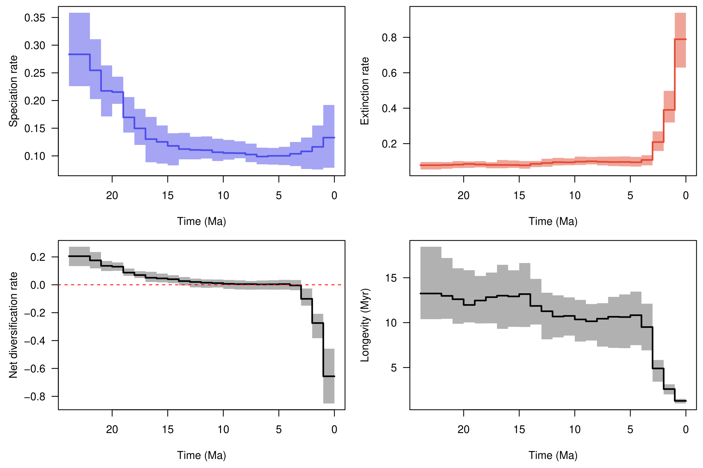
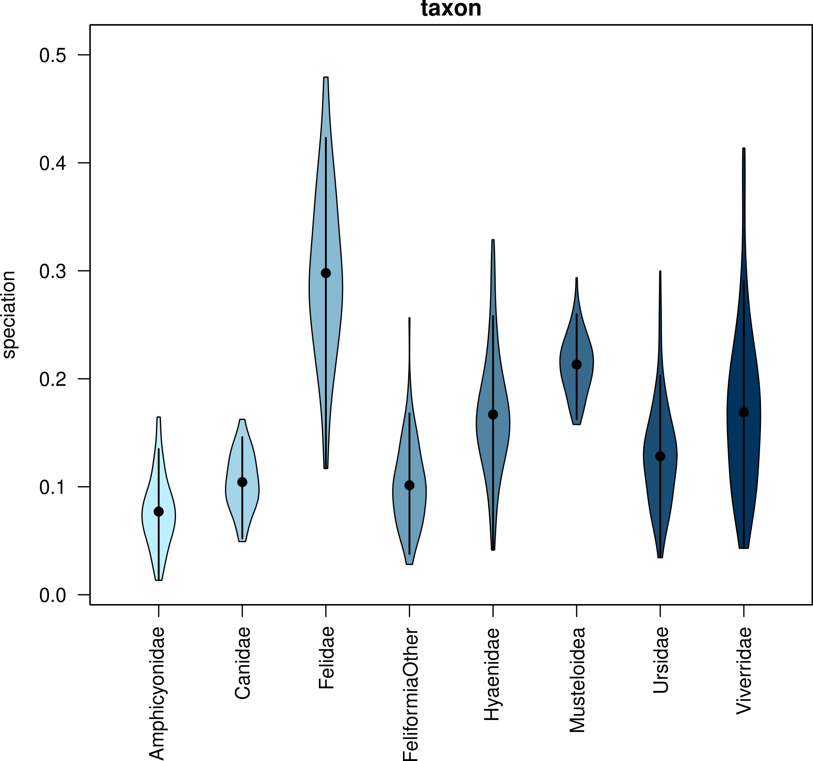
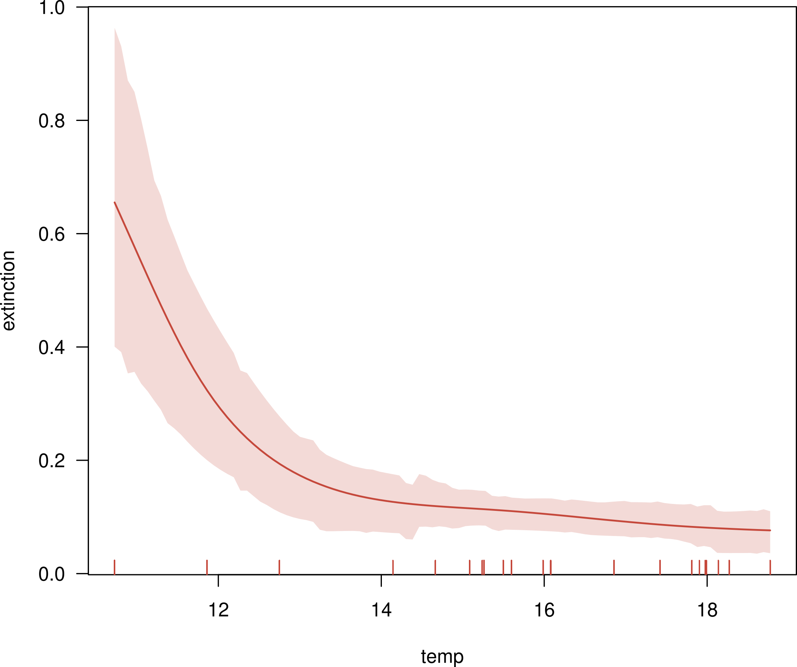
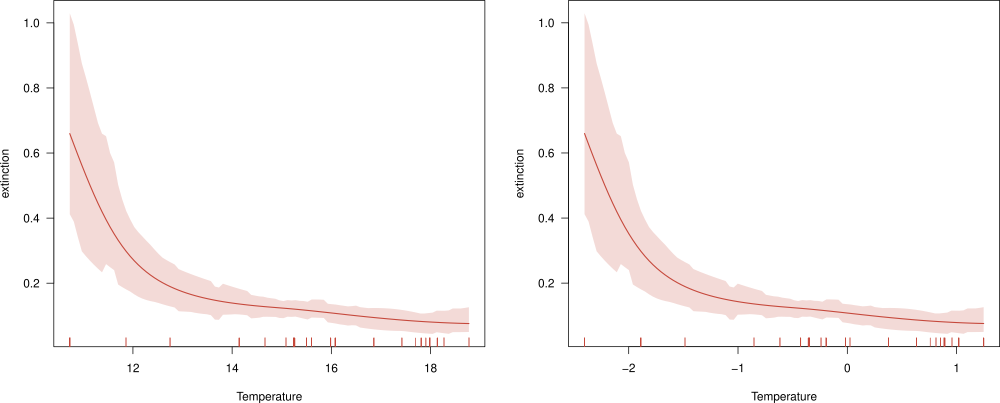
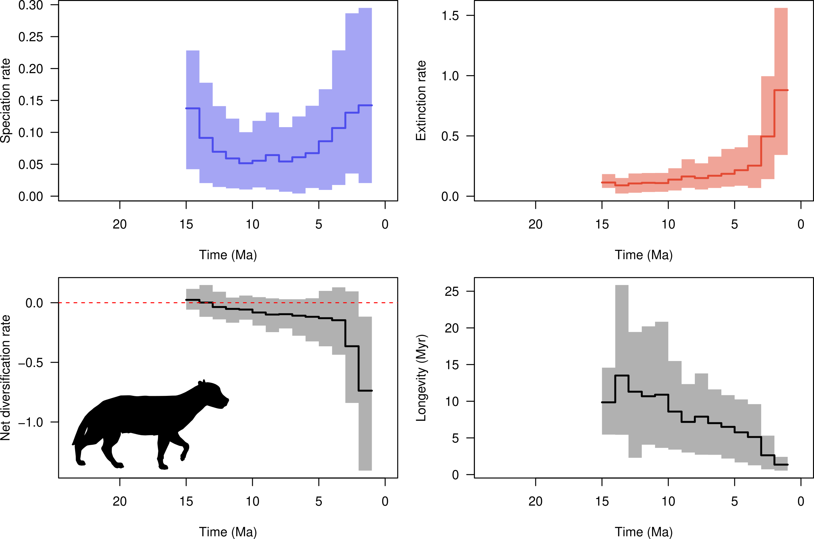
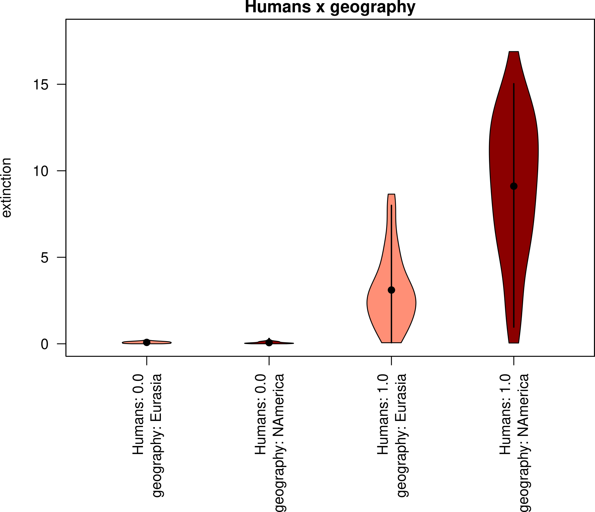

# PyRate 教程 \#7

***  
#### 目录
* [BDNN 模型](https://github.com/dsilvestro/PyRate/blob/master/tutorials/pyrate_tutorial_bdnn.md#the-bdnn-model)
* [快速示例](https://github.com/dsilvestro/PyRate/blob/master/tutorials/pyrate_tutorial_bdnn.md#complete-example-for-the-impatient)
* [构建 BDNN 数据集](https://github.com/dsilvestro/PyRate/blob/master/tutorials/pyrate_tutorial_bdnn.md#setting-up-a-bdnn-dataset)
* [速率随时间变化图](https://github.com/dsilvestro/PyRate/blob/master/tutorials/pyrate_tutorial_bdnn.md#plotting-marginal-rates-through-time)
* [效应图](https://github.com/dsilvestro/PyRate/blob/master/tutorials/pyrate_tutorial_bdnn.md#partial-dependence-plots)
* [预测变量重要性](https://github.com/dsilvestro/PyRate/blob/master/tutorials/pyrate_tutorial_bdnn.md#predictor-importance)
* [跨重复运行合并 BDNN 文件](https://github.com/dsilvestro/PyRate/blob/master/tutorials/pyrate_tutorial_bdnn.md#combining-bdnn-files-across-replicates)
* [起源与灭绝时间的估计](https://github.com/dsilvestro/PyRate/blob/master/tutorials/pyrate_tutorial_bdnn.md#estimated-times-of-origination-and-extinction)
* [返回索引](https://github.com/dsilvestro/PyRate/tree/master/tutorials#pyrate-tutorials---index)
***


# BDNN 模型

出生-死亡神经网络模型（birth-death neural-network model）以如下几类因素为函数，逐谱系并随时间地调节物种形成速率与灭绝速率：

1. **时间**
2. 一个或多个**分类性状和/或连续性状**（例如食性、体重、地理分布范围）
3. 一个或多个**随时间变化的变量**（例如古温度）
4. **系统发育亲缘关系**（例如归入高阶分类单元的分类方案或系统发育特征向量）

由于该函数基于全连接前馈神经网络构建，因此不依赖于对其形状的*先验（a priori）*假设。例如，它可以刻画速率对预测变量变化所作出的非线性、非单调响应。
它还可以考虑预测变量之间的任意交互作用。

BDNN 模型的参数与所有分类单元的起源和灭绝时间以及保存率一并联合估计。
其输出可用于估计速率随时间、随物种的变化，并识别造成这种变化的最重要预测变量及其单独或组合的效应。

---
## 给急于上手者的完整示例
这是 BDNN 分析全部步骤的一个简短示例。整个过程大约需要 45 分钟，并假定读者对 PyRate 已有一定了解。所有步骤、各步骤的可选参数以及输出文件，均在下面相应的章节中说明。

#### 进入你的 PyRate 文件夹
```
cd /your/path/to/PyRate-master
```

此处我们使用一份[示例数据集](https://github.com/dsilvestro/PyRate/tree/master/example_files/BDNN_examples/Carnivora)，其中包含 Carnivora 的化石产出记录数据、其性状、古温度，以及一个指定取样速率随时间发生转变的文件。详情见[构建 BDNN 数据集](https://github.com/dsilvestro/PyRate/blob/master/tutorials/pyrate_tutorial_bdnn.md#setting-up-a-bdnn-dataset)一节。

#### 运行一次 BDNN 推断
```
python ./PyRate.py ./example_files/BDNN_examples/Carnivora/Carnivora_occs.py -BDNNmodel 1 -trait_file ./example_files/BDNN_examples/Carnivora/Traits.txt -BDNNtimevar ./example_files/BDNN_examples/Carnivora/Paleotemperature.txt -mG -qShift ./example_files/BDNN_examples/Carnivora/Stages.txt -n 200001 -p 20000 -s 5000
```

#### 绘制物种形成与灭绝速率随时间变化图
`-plotBDNN` 命令将生成一个包含边缘速率随时间变化（rates through time, RTT）的 PDF 文件。
```
python ./PyRate.py -plotBDNN ./example_files/BDNN_examples/Carnivora/pyrate_mcmc_logs/Carnivora_occs_1_G_BD1-1_BDNN_16_8TVc_mcmc.log -b 0.5
```

可选参数 `-b 0.5` 舍弃 50% 的马尔可夫链蒙特卡洛（MCMC）样本作为烧录期（burn-in）。展示部分分类单元 RTT 的其他选项详见[下文](https://github.com/dsilvestro/PyRate/blob/master/tutorials/pyrate_tutorial_bdnn.md#plotting-marginal-rates-through-time)。


用 `-plotBDNN` 命令得到的 Carnivora BDNN 分析速率随时间变化图。


#### 展示性状与古温度对速率的影响
我们可以使用 `-plotBDNN_effects` 命令创建偏依赖图（partial dependence plots, PDP），以可视化单个预测变量以及所有双向交互作用对物种形成速率和灭绝速率的影响。
```
python ./PyRate.py -plotBDNN_effects ./example_files/BDNN_examples/Carnivora/pyrate_mcmc_logs/Carnivora_occs_1_G_BD1-1_BDNN_16_8TVc_mcmc.log -plotBDNN_transf_features ./example_files/BDNN_examples/Carnivora/Backscale.txt -BDNN_groups "{\"geography\": [\"Eurasia\", \"NAmerica\"], \"taxon\": [\"Amphicyonidae\", \"Canidae\", \"Felidae\", \"FeliformiaOther\", \"Hyaenidae\", \"Musteloidea\", \"Ursidae\", \"Viverridae\"]}" -b 0.5
```

可选参数 `-plotBDNN_transf_features` 将经过 z 变换的连续性状和时序预测变量重新缩放回其原始尺度。`-BDNN_groups` 用于在同一张图中展示具有多个无序状态的分类预测变量，例如每个分类单元所属的科。性状编码的详情见[构建 BDNN 数据集](https://github.com/dsilvestro/PyRate/blob/master/tutorials/pyrate_tutorial_bdnn.md#setting-up-a-bdnn-dataset)。


偏依赖图显示，Carnivora 各科的物种形成速率存在差异。

&nbsp;


偏依赖图显示，较低的温度对应较高的灭绝速率。x 轴上的刻度展示在推断出的各物种灭绝时间上预测变量的观测值。


#### 获取预测变量重要性
在最后一步中，我们 (a) 判断物种—时间特异性速率的变化是否超出恒定分化过程下的期望，(b) 依据各预测变量对物种形成速率与灭绝速率的影响对其进行排序。
```
python ./PyRate.py -BDNN_pred_importance ./example_files/BDNN_examples/Carnivora/pyrate_mcmc_logs/Carnivora_occs_1_G_BD1-1_BDNN_16_8TVc_mcmc.log -plotBDNN_transf_features ./example_files/BDNN_examples/Carnivora/Backscale.txt -BDNN_groups "{\"geography\": [\"Eurasia\", \"NAmerica\"], \"taxon\": [\"Amphicyonidae\", \"Canidae\", \"Felidae\", \"FeliformiaOther\", \"Hyaenidae\", \"Musteloidea\", \"Ursidae\", \"Viverridae\"]}" -b 0.5 -BDNN_nsim_expected_cv 10
```

我们将可选参数 `-BDNN_nsim_expected_cv` 设为 10（而非默认的 100），以便在为急于上手者求取期望速率变化时节省一些时间。

`-BDNN_pred_importance` 命令会在日志文件所在文件夹中生成七个文件。`_coefficient_of_rate_variation.csv` 文件汇总了推断出的物种形成速率与灭绝速率在各分类单元之间的变化，并将其与恒定分化过程下速率变化的上 95% 分位数进行比较；该恒定分化过程具有与所分析数据集相同的根年龄，以及相近（± 25%）的分类单元数目。若输出的经验速率变化高于期望值，就可以深入探究主要是哪些预测变量导致了这种变化。

| rate | cv_empirical | cv_expected |
|:---- |:------------:|:-----------:|
speciation | 0.55 | 0.29
extinction | 0.82 | 0.34


`_sp_predictor_influence.csv` 与 `_ex_predictor_influence.csv` 文件根据三种可解释人工智能（explainable artificial intelligence）指标的一致性结果，给出预测变量（即神经网络的特征）的重要性排序。此处以对灭绝速率最重要的三个预测变量为例，展示该表的主要内容：

| feature1 | feature1_state | posterior_probability | shap | delta_lik | rank |
|:-------- |:-------------- | ---------------------:| ----:| ---------:| ----:|
taxon | Amphicyonidae_Canidae | 0.9 | 0.17 | -72.6 | 2
taxon | Amphicyonidae_Felidae | 0.8 | 0.17 | -72.6 | 2
geography | Eurasia_NAmerica | 0.6 | 0.09 | -68.1 | 3
temp | none | 1.0 | 0.28 | -215.8 | 1

表中 `feature1` 列列出各个预测变量；`feature1_state` 给出分类预测变量的两两比较；`posterior_probability` 量化预测变量效应方向的一致性（例如，在子抽样的 10 个 MCMC 世代中，Amphicyonidae 科具有高于 Canidae 科的灭绝速率的世代比例）；`shap` 衡量预测变量的效应大小（例如欧亚大陆与北美洲的 Carnivora 灭绝速率相差 0.09 个单位）；`delta_lik` 表示打乱（permuting）该预测变量时模型似然的下降量；最后 `rank` 列给出上述三种指标各自重要性排序之间的共识排名。

有关该表的更多细节、获取预测变量重要性时其余四个输出文件，以及 `-BDNN_pred_importance` 命令的可选参数，将在[下文](https://github.com/dsilvestro/PyRate/blob/master/tutorials/pyrate_tutorial_bdnn.md#predictor_importance)中说明。


---
## 构建 BDNN 数据集
BDNN 模型需要采用 [PyRate 标准格式](https://github.com/dsilvestro/PyRate/blob/master/tutorials/pyrate_tutorial_1.md)的产出记录数据。
此外，它还可以使用物种与时间特异的数据。
含有物种特异性性状的制表符分隔文本文件可通过 `-trait_table` 命令载入分析，而含有时间序列预测变量的表格可通过 `-BDNNtimevar` 命令载入。

我们提供一份[示例数据集](https://github.com/dsilvestro/PyRate/tree/master/example_files/BDNN_examples/Carnivora)，其基于 [Hauffe et al 2022 MEE](https://doi.org/10.1111/2041-210X.13845)。其中包括北半球新生代 Carnivora 的属级产出记录数据、一张含古温度时间序列的表格，以及一张含谱系特异性性状的表格：经对数转换的体重、分类学信息（科一级分类），以及产出所在大陆（Eurasia 与 North America）。这些表格都是带表头的简单制表符分隔文本文件。

需要注意的是，为改善模型收敛，**连续性状与时间序列预测变量应当进行 z 变换**（即减去均值并除以标准差）。原始均值与标准差可存储在制表符分隔的文本文件中（示例见 [`Backscale.txt`](https://github.com/dsilvestro/PyRate/tree/master/example_files/BDNN_examples/Carnivora/Backscale.txt) 文件），并在绘图函数中用于[在原始尺度上展示结果](https://github.com/dsilvestro/PyRate/blob/master/tutorials/pyrate_tutorial_bdnn.md#partial-dependence-plots)。

物种特异性性状必须完整，即不存在缺失的状态或测量值。对于存在性状缺失的分类单元，要么将其纳入，要么可以对缺失值进行插补。


#### 分类性状
分类性状可以是二元的（即该性状只有两个状态）、无序的，或具有多个状态。
对于某个二元性状，若一个分类单元只能取两个状态之一（例如某一分类单元是否为水生），应采用 0-1 编码。

| scientificName | Aquatic |
| -------------- |:-------:|
Orcinus | 1
Cavia | 0


具有两个以上状态的无序性状应采用 one-hot 编码。例如分类单元的“科的归属”。

| scientificName | Felidae | Musteloidea | Ursidae |
| -------------- |:-------:|:-----------:|:-------:|
Acinonyx | 1 | 0 | 0
Actiocyon | 0 | 1 | 0
Agriotherium | 0 | 0 | 1


若某个无序性状中一个分类单元可以同时具有多个状态，也应采用 one-hot 编码。一个例子是分类单元在两个地区的地理分布。

| scientificName | Eurasia | NAmerica |
| -------------- |:-------:|:--------:|
Acinonyx | 1 | 0
Actiocyon | 0 | 1
Agriotherium | 1 | 1


具有两个以上状态的有序性状应以整数编码。若状态数目很多，最好将其中心化为零（即减去最接近各状态中位数的实数值），并把该性状加入 `Backscale.txt` 供 `-plotBDNN_transf_features` 参数使用，其中第一行的值等于中位数，第二行的值设为 1。例如，六个分类单元的状态为 0、0、1、2、3、4，由于中位数为 1.5，故每个状态都减去 2。

| scientificName | Ordered_trait |
| -------------- |--------------:|
Taxon_0 | -2
Taxon_1 | -2
Taxon_2 | -1
Taxon_3 | 0
Taxon_4 | 1
Taxon_5 | 2

为使偏依赖图的标签从零开始，供 `-plotBDNN_transf_features` 参数使用的文件随后应包含类似下面这样的列：

| Ordered_trait |
|:-------------:|
| 2 |
| 1 |

#### 环境变量时间序列
供 `-BDNNtimevar` 参数使用的时间序列（例如环境变量或生物协变量）需要以 **time** 作为第一列，其后各列为实际的时间序列变量。这些变量应进行 z 变换以改善模型收敛。

| Time | Temperature | Prey |
------:| -----------:| ----:|
0.00 | -1.16 | -1.34
0.09 | -2.71 | -0.52
0.14 | -3.39 | -0.47
0.33 | -1.08 | -0.01
1.17 | -1.44 | 0.23
2.91 | -0.77 | 0.68
7.35 | -0.22 | 1.19

用于执行 z 变换的均值与标准差应写入一个可选的制表符分隔文本文件，其中第一行为均值，第二行为标准差。在上述有序分类性状的假设用法基础上加入温度，可得到如下的 `-plotBDNN_transf_features` 文件：

| Ordered_trait | Temperature |
|:-------------:| -----------:|
| 2 | 16.02 |
| 1 | 2.20 |


不过 `-plotBDNN_transf_features` 是可选的，它不会改变 BDNN 模型的推断本身。但使用 `-plotBDNN_effects` 命令绘制的效应图会更有意义。


由同一份 BDNN 日志文件创建效应图时，是否使用 `-plotBDNN_transf_features` 参数反转温度的 z 变换，对 Carnivora 灭绝速率温度效应的展示对比（右：反转；左：未反转）。

<br/><br/>

通过用 `-BDNNtimevar` 提供两个文本文件的路径，可以为物种形成和灭绝使用不同的时间序列。不过这些文件应具有相同的列名。例如，人类的出现可能影响灭绝速率，但不影响物种形成速率。

```
python ./PyRate.py ./example_files/BDNN_examples/Carnivora/Carnivora_occs.py -BDNNmodel 1 -trait_file ./example_files/BDNN_examples/Carnivora/Traits.txt -BDNNtimevar ./example_files/BDNN_examples/Carnivora/Advanced_examples/Paleotemperature_nohumans.txt ./example_files/BDNN_examples/Carnivora/Advanced_examples/Paleotemperature_humans.txt -fixShift ./example_files/BDNN_examples/Carnivora/Advanced_examples/Time_windows.txt -mG -qShift ./example_files/BDNN_examples/Carnivora/Stages.txt -out _different_timevar -n 200001 -p 20000 -s 5000
```


时间序列数据也可以采用已经分箱的形式提供。这必须与神经网络的时间箱相匹配，默认时间箱为 1 myr（另见[自定义时间箱的用法](https://github.com/dsilvestro/PyRate/blob/master/tutorials/pyrate_tutorial_bdnn.md#replacing-default-1-myr-bins)）。

| Time | Temperature |
------:| -----------:|
0.0 | 0.0-0.9999 Ma 区间的平均值
1.0 | 1.0-1.9999 Ma 区间的平均值
2.0 | 2.0-2.9999 Ma 区间的平均值


---
## 运行一次 BDNN 推断
要进行 BDNN 分析，我们需要提供产出记录文件并使用 `-BDNNmodel 1` 命令。默认情况下，BDNN 模型只把时间作为预测变量，并按 1-myr 时间箱离散化。此外，应通过 `-trait_file` 参数将性状纳入 BDNN 模型，并可用 `-BDNNtimevar` 添加环境变量等时间序列。通过设置 `-BDNNtimetrait 0` 可以省略时间这一预测变量，但这样做应当有充分的理由。

所有用于[定义保存模型](https://github.com/dsilvestro/PyRate/blob/master/tutorials/pyrate_tutorial_1.md#defining-the-preservation-model)的标准命令都可以与 BDNN 模型组合使用。
此处我们使用 `-qShift` 命令为随时间变化的保存过程指定时间箱，并用 `-mG` 推断物种之间取样速率的差异。

分析按如下方式启动：
```
python ./PyRate.py ./example_files/BDNN_examples/Carnivora/Carnivora_occs.py -BDNNmodel 1 -BDNNtimevar ./example_files/BDNN_examples/Carnivora/Paleotemperature.txt -trait_file ./example_files/BDNN_examples/Carnivora/Traits.txt -qShift ./example_files/BDNN_examples/Carnivora/Stages.txt -mG -n 20000001 -s 20000 -p 10000
```
其中 `-s` 与 `-n` 用于定义抽样频率和 MCMC 迭代总次数，而 `-p` 设置屏幕上打印信息的频率。指定网络结构与先验设置的其他超参数列于[其他选项](https://github.com/dsilvestro/PyRate/blob/master/tutorials/pyrate_tutorial_bdnn.md#other-options)之下。 

与 PyRate 中的一贯做法相同，不同的重复运行可用 `-j` 参数选择（例如 `-j 2` 表示第二次重复）。按上述设置运行一次分析大约需要半天时间。此类较长推断的输出文件包含在 [Example_output](https://github.com/dsilvestro/PyRate/tree/master/example_files/BDNN_examples/Carnivora/Advanced_examples/Example_output) 中。


#### 替换默认的 1-myr 时间箱
虽然分类单元的起源与灭绝时间是在连续时间中推断的，但 BDNN 的时间效应与时间序列数据默认被分入 1-myr 时间箱。如果你想使用不同的时间箱大小，可以用例如 `-BDNNtimeres 0.5` 将所有时间箱设为 0.5 百万年。若要指定不等长的时间箱，请使用 `-fixShift` 命令提供定义自定义时间箱边界的文件路径。自定义时间箱例如可用于捕捉更新世（Pleistocene）较高的温度变异性（而不是像默认 1-myr 时间箱那样只取 0&mdash;1 和 1&mdash;2 的平均值）。此外，对于化石产出记录稀少的时期，较大的时间箱可能更为适用，并且会使 BDNN 运行更快。用于自定义时间箱的 `-fixShift` 文件应与保存模型 `-qShift` 所用文件格式相同（即无表头，只有年龄）。示例见 [Advanced_examples](https://github.com/dsilvestro/PyRate/tree/master/example_files/BDNN_examples/Carnivora/Advanced_examples/Time_windows.txt)

|        |
|--------|
| 0.0117 |
| 0.126 |
| 0.781 |
| 1.8 |

只需在 BDNN 命令中加入 `-fixShift` 参数：
```
python ./PyRate.py ./example_files/BDNN_examples/Carnivora/Carnivora_occs.py -BDNNmodel 1 -BDNNtimevar ./example_files/BDNN_examples/Carnivora/Paleotemperature.txt -trait_file ./example_files/BDNN_examples/Carnivora/Traits.txt -fixShift ./example_files/BDNN_examples/Carnivora/Advanced_examples/Time_windows.txt -qShift ./example_files/BDNN_examples/Carnivora/Stages.txt -mG -out _time_windows -n 20000001 -s 20000 -p 10000
```

与其他 PyRate 分析一样，`-out` 参数允许我们为输出文件添加后缀。此处我们添加 __time_windows_ 以区别于先前的 BDNN 运行。该 BDNN 模型的输出文件包含在 [Example_output](https://github.com/dsilvestro/PyRate/tree/master/example_files/BDNN_examples/Carnivora/Advanced_examples/Example_output) 中，可与其他分析进行对比。

---
## 输出后处理

### 绘制边缘速率随时间变化图
BDNN 模型推断出的边缘物种形成速率与灭绝速率随时间变化情况可用 `-plotBDNN` 绘制：

```
python ./PyRate.py -plotBDNN ./example_files/BDNN_examples/Carnivora/pyrate_mcmc_logs/Carnivora_occs_1_G_BDS_BDNN_16_8TVc_mcmc.log -b 0.1
```

其中 `-b 0.1` 指定烧录期比例。该命令使用 `pyrate_mcmc_logs` 目录中的 `_sp_rates.log` 与 `_ex_rates.log` 文件。命令将生成一个 PDF 文件和一个包含速率随时间变化图的 R 脚本，二者均保存在 `pyrate_mcmc_logs` 目录中。添加 `-logT 2` 可在对数尺度上展示速率，并可用 `-root_plot` 与 `-min_age_plot` 对时间范围进行截断。R 脚本文件可编辑以自定义图形。


#### 特定分类单元组的边缘速率随时间变化图
可以只为分类单元的一个子集绘制速率随时间变化图，例如为一组具有相同性状的分类单元绘制。分组信息需要以制表符分隔的文本文件提供，将分类单元名称指派给相应的组。例如，[示例分组文件](https://github.com/dsilvestro/PyRate/tree/master/example_files/BDNN_examples/Carnivora/Advanced_examples/RTT_groups.csv)指定了属于 Amphicyonidae、Canidae 或 Musteloidea 科、产于 Eurasia、体重小于 10 kg，或仅为贪食的食客（_Borophagus_）的 Carnivora 子集。

```
python ./PyRate.py -plotBDNN ./example_files/BDNN_examples/Carnivora/pyrate_mcmc_logs/Carnivora_occs_1_G_BDS_BDNN_16_8TVc_mcmc.log -b 0.1 -plotBDNN_groups ./example_files/BDNN_examples/Carnivora/Advanced_examples/RTT_groups.csv
```


贪食的食客（<i>Borophagus</i>）的物种特异性速率随时间变化图。


---
### 偏依赖图
现在我们可以生成偏依赖图，以分离每个预测变量对速率的单独效应以及每对预测变量的组合效应（用于评估交互作用）。PDP 会对其余预测变量取边际化，即消除它们的影响，只展示归因于相应预测变量的效应。虽然净分化速率本身并不是被推断的模型参数，但我们可以通过从物种形成 PDP 中减去灭绝 PDP 来展示对其的效应。这通过 `-plotBDNN_effects` 命令载入 `*mcmc.log` 文件来实现。我们还额外使用 `-BDNN_groups` 函数来指定哪些变量经过 one-hot 编码并属于同一类别（例如这里所有科属于名为 `taxon` 的类别）。

```
python ./PyRate.py -plotBDNN_effects ./example_files/BDNN_examples/Carnivora/pyrate_mcmc_logs/Carnivora_occs_1_G_BDS_BDNN_16_8TVc_mcmc.log -plotBDNN_transf_features ./example_files/BDNN_examples/Carnivora/Backscale.txt -BDNN_groups "{\"geography\": [\"Eurasia\", \"NAmerica\"], \"taxon\": [\"Amphicyonidae\", \"Canidae\", \"Felidae\", \"FeliformiaOther\", \"Hyaenidae\", \"Musteloidea\", \"Ursidae\", \"Viverridae\"]}" -b 0.1 -resample 100
```

我们还额外指定烧录期比例以及 PDP 中所考虑的后验样本数（`-resample`），因为日志文件可能包含成千上万个样本。不过 100 个样本通常已经足够。

该命令将生成一个 PDF 文件和一个包含偏依赖图的 R 脚本，二者均保存在 `pyrate_mcmc_logs` 目录中。可编辑 R 脚本文件以自定义 PDP。

注意 `-BDNN_groups` 的写法中包含*转义引号（即 \"）。如果你使用的是 Linux 或 Mac 系统，该表达式可以简化为外层用单引号、性状及其状态用双引号。
```
-BDNN_groups '{"geography": ["Eurasia", "NAmerica"], "taxon": ["Amphicyonidae", "Canidae", "Felidae", "FeliformiaOther", "Hyaenidae", "Musteloidea", "Ursidae", "Viverridae"]}'
```

可选参数：

* `-b`：烧录期比例（默认 0.1）。

* `-resample`：烧录期之后的 MCMC 样本数目（默认使用全部样本）。

* `-plotBDNN_transf_features`：含均值与标准差的制表符分隔文本文件，用于反转连续预测变量的 z 变换，示例见 [`Backscale.txt`](https://github.com/dsilvestro/PyRate/tree/master/example_files/BDNN_examples/Carnivora/Backscale.txt) 文件。

* `-BDNN_groups`：字符串，用于将某个性状的所有 one-hot 编码状态绘制在同一张图中。

* `-root_plot` 与 `-min_age_plot`：只考虑在该时间窗口内起源或灭绝的分类单元。

* `-thread`：用于并行计算重要性指标的 CPU 核心数；例如 `-thread 2 0` 表示使用两个核心。


#### 两个以上预测变量的偏依赖速率

偏依赖图只展示单个预测变量或两个预测变量之间双向交互作用对物种形成速率与灭绝速率的效应。不过，你可以用 `-BDNN_interaction` 命令获得包含任意预测变量组合的偏依赖速率文本文件。该计算可能耗时较长并占用大量内存，尤其是连续预测变量，因为三个连续预测变量需要计算 100 x 100 x 100 个速率。各个预测变量需要用 `-BDNN_groups` 参数指定。

下面是获取体重、温度与时间三个预测变量（即对科的效应与地理分布的效应进行边际化）偏依赖速率的示例：
```
python ./PyRate.py -BDNN_interaction ./example_files/BDNN_examples/Carnivora/pyrate_mcmc_logs/Carnivora_occs_1_G_BDS_BDNN_16_8TVc_mcmc.log -plotBDNN_transf_features ./example_files/BDNN_examples/Carnivora/Backscale.txt -BDNN_groups "{\"BodyMass\": [\"BodyMass\"], \"Temperature\": [\"Temperature\"], \"time\": [\"time\"]}" -b 0.5 -resample 3
```

它会在 *pyrate_mcmc_logs* 文件夹中生成四个文本文件（两个用于物种形成，两个用于灭绝）：
*_pdp.csv* 文件的前若干列（列名依据 `-BDNN_groups` 而定）给出用于计算平均速率及其上下 95% 可信区间的预测变量取值组合（最后三列分别为均值、下界与上界）。

| BodyMass | Temperature | time | mean | lwr | upr |
----------:| -----------:| ----:| ----:| ---:| ---:|
-0.73 | 10.73 | 0.5 | 0.16 | 0.16 | 0.11 | 0.25
-0.52 | 11.13 | 16.05 | 0.47 | 0.35 | 0.67

另一个文本文件则简单地给出各分类单元在其推断起源或灭绝时刻的预测变量取值。该文件可用于例如将 *_pdp.csv* 文件截断到预测变量的观测取值范围内。

若要获取两个以上预测变量的偏依赖速率，`-BDNN_groups` 中可以混合连续预测变量与分类预测变量（而该选项通常用于 one-hot 编码的分类性状）。
```
python ./PyRate.py -BDNN_interaction ./example_files/BDNN_examples/Carnivora/pyrate_mcmc_logs/Carnivora_occs_1_G_BDS_BDNN_16_8TVc_mcmc.log -plotBDNN_transf_features ./example_files/BDNN_examples/Carnivora/Backscale.txt -BDNN_groups "{\"BodyMass\": [\"BodyMass\"], \"Temperature\": [\"Temperature\"], \"taxon\": [\"Amphicyonidae\", \"Canidae\", \"Felidae\", \"FeliformiaOther\", \"Hyaenidae\", \"Musteloidea\", \"Ursidae\", \"Viverridae\"]}" -b 0.5 -resample 3
```

`-BDNN_interaction` 命令还可用于获取物种特异性的物种形成速率与灭绝速率。我们不必计算 `-BDNN_groups` 中所有预测变量取值组合的速率，而可以只针对产出记录数据集中的分类单元计算。这实质上是在问：*如果一个分类单元的科与其地理分布都不产生影响，那么它在起源（或灭绝）时刻的物种形成（或灭绝）速率会是多少？*我们只需添加参数 `-BDNN_interaction_fix`。
```
python ./PyRate.py -BDNN_interaction ./example_files/BDNN_examples/Carnivora/pyrate_mcmc_logs/Carnivora_occs_1_G_BDS_BDNN_16_8TVc_mcmc.log -BDNN_interaction_fix -plotBDNN_transf_features ./example_files/BDNN_examples/Carnivora/Backscale.txt -BDNN_groups "{\"BodyMass\": [\"BodyMass\"], \"Temperature\": [\"Temperature\"], \"time\": [\"time\"]}" -b 0.5 -resample 3
```

---
### 预测变量重要性

最后，我们可以用三种指标的组合来计算每个预测变量的重要性：1) 效应的边缘后验概率，2) 预测变量对速率的效应大小（SHAP 值），以及 3) 预测变量对模型拟合的影响（特征置换）。

这通过 `-BDNN_pred_importance` 命令载入 `* mcmc.log` 文件来实现。我们再次使用 `-BDNN_groups` 函数来指定哪些变量属于同一类别。

```
python PyRate.py -BDNN_pred_importance ./example_files/BDNN_examples/Carnivora/pyrate_mcmc_logs/Carnivora_occs_1_G_BDS_BDNN_16_8TVc_mcmc.log -BDNN_groups "{\"geography\": [\"Eurasia\", \"NAmerica\"], \"taxon\": [\"Amphicyonidae\", \"Canidae\", \"Felidae\", \"FeliformiaOther\", \"Hyaenidae\", \"Musteloidea\", \"Ursidae\", \"Viverridae\"]}" -b 0.1 -resample 10 -BDNN_nsim_expected_cv 7 -BDNN_pred_importance_nperm 23
```

可选参数：

* `-b`：烧录期比例（默认 0.1）。

* `-resample`：烧录期之后的 MCMC 样本数目（默认使用全部样本）。

* `-BDNN_nsim_expected_cv`：用于求取物种—时间特异性物种形成与灭绝速率期望变化的恒定分化模拟次数（默认：100）。将其设为 0 时，将跳过获取期望速率变化的后处理步骤。

* `-BDNN_pred_importance_nperm`：设置特征置换的次数（默认：100）。

* `-BDNN_pred_importance_interaction`：添加此参数可同时对预测变量的双向交互作用进行排序。取决于预测变量的数目，这会显著变慢。

* `-BDNN_pred_importance_window_size`：特征置换会自动对不同大小的时间箱进行校正（见[自定义时间箱的用法](https://github.com/dsilvestro/PyRate/blob/master/tutorials/pyrate_tutorial_bdnn.md#replacing-default-1-myr-bins)）。不过，如果最短的时间箱非常小（例如全新世），这会耗时极长。可将自动校正调整为稍大一些的值，例如 `-BDNN_pred_importance_window_size 0.1`。

* `-BDNN_groups`：字符串，用于计算一组特征的综合重要性，例如 one-hot 编码的分类性状各状态。但它对一组连续性状同样有效（不过不能与 `-BDNN_pred_importance_interaction` 组合使用）

* `-BDNN_mean_shap_per_group`：对某个 `-BDNN_groups` 的所有状态取均值而非求和，以获得该组的总体重要性。当某个性状的状态很多时，这可能更为稳健。

* `-root_plot` 与 `-min_age_plot`：只考虑在该时间窗口内起源或灭绝的分类单元。

* `-thread`：用于并行计算重要性指标的 CPU 核心数；例如 `-thread 2 0` 表示使用两个核心。


`-BDNN_pred_importance` 命令将生成两张制表符分隔的表格，给出每个预测变量对物种形成速率与灭绝速率重要性的估计及排序。它还会生成一个 PDF 文件和一个 R 脚本，包含谱系特异性的物种形成速率与灭绝速率，以及它们如何受预测变量取值影响的估计。


---
### 其他选项

一组**超参数**可用于定义 BDNN 中所实现神经网络的架构。

`-BDNNnodes 16 8`：定义层数以及每层的节点数（默认：两层，分别为 18 和 8 个节点）；30 20 10 则指定三层，分别为 30、20 和 10 个节点。

`-BDNNoutputfun`：输出层的激活函数：0) abs, 1) softPlus, 2) exp, 3) relu 4) sigmoid 5) sigmoid_rate (default=5)

`-BDNNactfun`：隐藏层的激活函数：0) tanh, 1) relu, 2) leaky_relu, 3) swish, 4) sigmoid (default=0)

`-BDNNreg`：指定是否通过将其设为 -1.0 来省略正则化层。截断指数先验的默认值 1.0 使“对 BDNN 预测变量无效应”具有最高的概率。更大的正值会增强这一权重。默认情况下，对物种形成速率与灭绝速率使用同一个 t<sub>reg</sub>。可通过提供两个值 `-BDNNreg 1.0 1.0` 使二者相互独立。`-BDNNreg 1.0 -1.0` 则对物种形成启用正则化，而对灭绝不启用。

`-BDNNprecision`：设置神经网络节点的浮点精度，并影响 BDNN 的运行速度。默认值 1 指 32 位单精度，即 7 位十进制数字。相较于 64 位取值，它在模型推断与后处理上更快。如果 per_species_rates.log 显示极小的数值（例如 0.000001），请使用 `-BDNNprecision 1` 启用这一双精度（即 16 位十进制数字）（更好的做法是对产出记录数据做 `-rescale`）。


#### 边界处的速率转变

与许多其他 [PyRate 分析](https://github.com/dsilvestro/PyRate/blob/master/tutorials/pyrate_tutorial_1.md#setting-fixed-shifts-at-the-boundaries,-while-searching-for-rate-shifts-between-them)一样，我们可以在边界处固定速率转变，同时在边界之间搜索速率变化。这可通过添加 `-edgeShift` 参数实现。添加 `-qFilter` 则允许在边界处出现取样速率的转变。

```
python ./PyRate.py ./example_files/BDNN_examples/Carnivora/Carnivora_occs.py -BDNNmodel 1 -trait_file ./example_files/BDNN_examples/Carnivora/Traits.txt -BDNNtimevar ./example_files/BDNN_examples/Carnivora/Paleotemperature.txt -mG -qShift ./example_files/BDNN_examples/Carnivora/Stages.txt -qFilter 0 -edgeShift 15.97 2.5 -out _edge -n 200001 -p 20000 -s 5000
```

随后可以用 `-min_age_plot` 与 `-root_plot` 参数在边界处截断速率随时间变化图。
```
python ./PyRate.py -plotBDNN ./example_files/BDNN_examples/Carnivora/pyrate_mcmc_logs/Carnivora_occs_1_edge_G_BD1-1_BDNN_16_8TVc_mcmc.log -min_age_plot 2.6 -root_plot 15.9 -b 0.5
```

---
### 指自定义预测变量

常规的 BDNN 分析通过 `-trait_file` 指定性状、并通过 `-BDNNtimevar` 命令纳入古环境变量，其假设是物种性状不随时间改变，且所有物种随时间经历相同的环境条件。可以让分析使用自行构建的表格来放宽这一假设。例如，不同地理区域的温度轨迹可能不同；或者人类可能影响灭绝速率，而对物种形成速率的影响并不可信。
这类分析可以用自定义表格来搭建，其格式与标准的 `-trait_file` 类似（即每一行为一个物种、每一列为一个性状（含古环境），但没有分类单元名称列）。若分析包含默认的时间效应，则每个时间箱需要一张自定义表格。当未用 `-fixShift` 指定时间箱之间的边界时（见[示例](https://github.com/dsilvestro/PyRate/blob/master/tutorials/pyrate_tutorial_bdnn.md#replacing-default-1-myr-bins)），这意味着每 100 万年一张表。否则，表格的数目需要等于边界的数目。自定义表格的文件名需要与时间箱对应，例如最近的时间箱为 *01.txt*，其后（更老的）时间箱为 *02.txt*，依此类推。
自定义表格通过 `-BDNNpath_taxon_time_tables` 命令用于 BDNN 分析，该参数接受一个包含这些自定义表格的文件夹路径。若只提供一个路径，则自定义表格同时作为物种形成速率与灭绝速率的预测变量。若给出两个路径，则第一个用于物种形成速率的预测变量，第二个用于灭绝速率。
不应再另外调用 `-trait_file` 与 `-BDNNtimevar`。

下面的示例使用自定义表格：在过去 126,000 年中人类存在于 Eurasia，而在 North America 人类主要自全新世起存在。这种与人类在时空上的重叠可能影响灭绝速率而不影响物种形成速率。此外，古温度轨迹是大洲特异的。
```
python ./PyRate.py ./example_files/BDNN_examples/Carnivora/Carnivora_occs.py -BDNNmodel 1 -BDNNpath_taxon_time_tables ./example_files/BDNN_examples/Carnivora/Advanced_examples/load_predictors/speciation ./example_files/BDNN_examples/Carnivora/Advanced_examples/load_predictors/extinction -fixShift ./example_files/BDNN_examples/Carnivora/Advanced_examples/Time_windows.txt -qShift ./example_files/BDNN_examples/Carnivora/Stages.txt -mG -out _taxon_time_tables -n 20000001 -s 20000 -p 10000
```

我们再次使用 `-out` 参数为输出文件添加后缀。该 BDNN 模型的输出文件名为 __taxon_time_tables_，并包含在 [Example_output](https://github.com/dsilvestro/PyRate/tree/master/example_files/BDNN_examples/Carnivora/Advanced_examples/Example_output) 中。


人类与 Carnivora 在时空上的重叠对其灭绝速率影响的偏依赖图。在 North America 这一效应更强，因为对于存活至全新世的物种，其自定义 BDNN 预测变量中只允许存在这一效应。对 Eurasia 的 Carnivora 而言，人类效应被允许存在于过去 126,000 年。<i>Humans1.0</i> 表示时空上的重叠。

&nbsp;

为帮助确定所需自定义表格的数目并得到正确的格式，PyRate 允许用 `-BDNNexport_taxon_time_tables` 标记，从一次 BDNN 分析中导出包含性状与环境预测变量的表格。随后可用文本编辑器或电子表格软件修改这些表格。
```
python ./PyRate.py ./example_files/BDNN_examples/Carnivora/Carnivora_occs.py -BDNNmodel 1 -BDNNtimevar ./example_files/BDNN_examples/Carnivora/Paleotemperature.txt -trait_file ./example_files/BDNN_examples/Carnivora/Traits.txt -fixShift ./example_files/BDNN_examples/Carnivora/Advanced_examples/Time_windows.txt -BDNNexport_taxon_time_tables
```

---
### 重启 BDNN 分析

BDNN 推断可能需要比预期更多的 MCMC 世代才能达到马尔可夫链的平稳分布，所选的世代数 `-n` 可能过小。此时，你可以使用 `-restore_mcmc` 参数从最后一个样本恢复马尔可夫链。

```
python ./PyRate.py ./example_files/BDNN_examples/Carnivora/Carnivora_occs.py -restore_mcmc ./example_files/BDNN_examples/Carnivora/pyrate_mcmc_logs/Carnivora_occs_1_G_BDS_BDNN_16_8TVc_mcmc.log -BDNNmodel 1 -trait_file ./example_files/BDNN_examples/Carnivora/Traits.txt -BDNNtimevar ./example_files/BDNN_examples/Carnivora/Paleotemperature.txt -mG -qShift ./example_files/BDNN_examples/Carnivora/Stages.txt -n 200001 -p 20000 -s 5000
```

---
### 跨重复运行合并 BDNN 文件

为处理化石产出记录中的年龄不确定性，你应当创建多个基于随机抽样年龄的重复运行（见 [PyRate 教程 1](https://github.com/dsilvestro/PyRate/blob/master/tutorials/pyrate_tutorial_1.md)）。可以对这些重复运行分别独立地进行 BDNN 推断，并合并它们的输出文件，以获得例如涵盖所有重复运行的单一速率随时间变化图，或跨重复运行的预测变量重要性。

与 PyRate 中的一贯做法相同，不同的重复运行可用 `-j` 参数选择。例如 Carnivora 示例数据集包含三个重复运行，第二次可用下面这行运行：

```
python ./PyRate.py ./example_files/BDNN_examples/Carnivora/Carnivora_occs.py -j 2 -BDNNmodel 1 -trait_file ./example_files/BDNN_examples/Carnivora/Traits.txt -BDNNtimevar ./example_files/BDNN_examples/Carnivora/Paleotemperature.txt -mG -qShift ./example_files/BDNN_examples/Carnivora/Stages.txt -n 200001 -p 20000 -s 5000
```

要将不同重复运行的日志文件合并为一个，可以使用命令：

```
python ./PyRate.py -combBDNN ./example_files/BDNN_examples/Carnivora/pyrate_mcmc_logs -b 0.25
```

其中 `path_to_your_log_files` 指定日志文件所在的目录（例如 pyrate_mcmc_logs）。 
该命令生成五个输出文件，分别名为“combined_[n]_mcmc.log”、"combined_[n]_per_species_rates.log"、"combined_[n]_sp_rates.log"、"combined_[n]_ex_rates.log" 和 combined_[n].pkl，其中 [n] 是被合并的重复运行数目。
标记 `-b 0.25` 指定应将每个文件中前 25% 的 MCMC 样本作为烧录期（burn-in）排除——究竟应排除多少烧录期样本，需要在检查 mcmc.log 文件之后确定，例如使用 Tracer。为避免生成过大的合并文件，可用 `-resample` 标记对每个日志文件进行子抽样。通常子抽样 100 个样本就已足够。

如果同一个 pyrate_mcmc_logs 文件夹中存在不同的 BDNN 分析（例如使用不同的预测变量组合），可用 `-tag` 参数选择相应的分析。例如，`-tag taxon_time_tables` 会指示 PyRate 合并所有文件名中包含 taxon_time_tables 的分析。

在合并各个重复运行时完成烧录期剔除与子抽样之后，我们在 `-plotBDNN_effects` 或 `-BDNN_pred_importance` 等后处理步骤中就不必再指定这些参数。

---
### 起源与灭绝时间的估计

BDNN 模型可以与先前 PyRate 分析获得的起源与灭绝时间相结合。此时输入文件是一张简单的表格，列出每个谱系的起源与灭绝时间。该表格可用 `-ginput` 命令生成，方法如[此处](https://github.com/dsilvestro/PyRate/blob/master/tutorials/pyrate_tutorial_2.md#generate-input-file-for-pyratecontinuous)所示。


#### 运行 PyRate 以推断起源与灭绝时间
```
python ./PyRate.py ./example_files/BDNN_examples/Carnivora/Carnivora_occs.py -A 4 -qShift ./example_files/BDNN_examples/Carnivora/Stages.txt -mG -n 1000001 -p 100000 -s 10000
```

#### 获取起源与灭绝的平均时间
```
python ./PyRate.py -ginput ./example_files/BDNN_examples/Carnivora/pyrate_mcmc_logs/Carnivora_occs_1_Grj_mcmc.log -b 0.25
```

#### 在固定的起源与灭绝时间上运行 BDNN
```
python ./PyRate.py -d ./example_files/BDNN_examples/Carnivora/pyrate_mcmc_logs/Carnivora_occs_1_Grj_se_est.txt -BDNNmodel 1 -trait_file ./example_files/BDNN_examples/Carnivora/Traits.txt -n 500001 -p 20000 -s 5000
```
