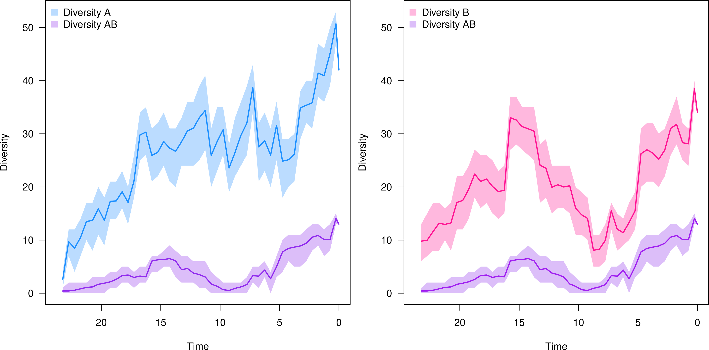
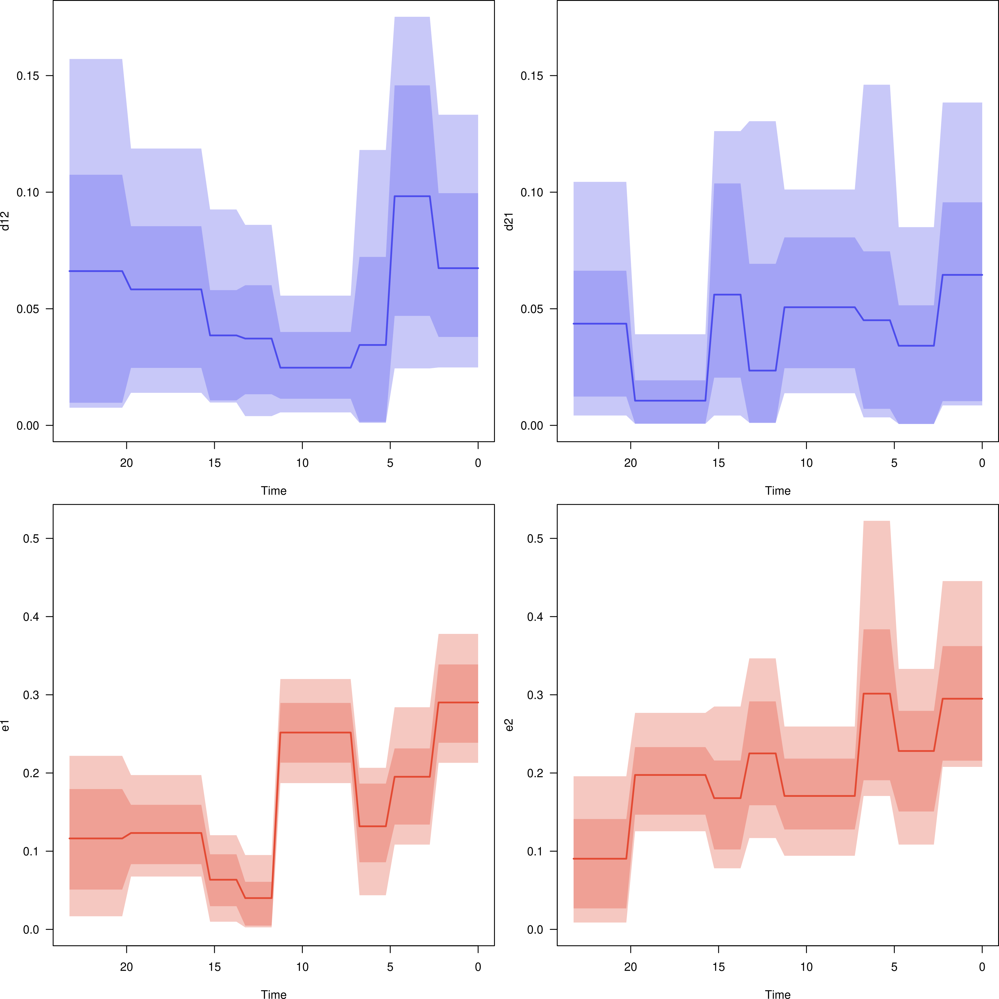
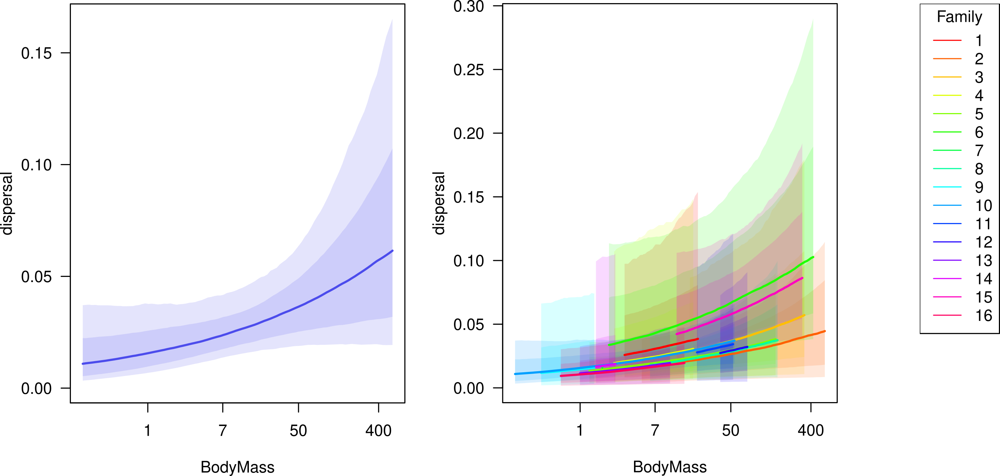
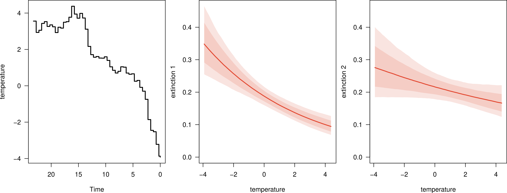

# 扩散-灭绝-取样（Dispersal Extinction Sampling, DES）模型
#### 2022 年 1 月
***
#### 目录
* [为 DES 分析准备输入数据](https://github.com/dsilvestro/PyRate/blob/master/tutorials/pyrate_tutorial_5.md#input-data-preparation)
* [运行 DES 分析](https://github.com/dsilvestro/PyRate/blob/master/tutorials/pyrate_tutorial_5.md#running-a-des-analysis)
* [汇总并绘制 DES 输出](https://github.com/dsilvestro/PyRate/blob/master/tutorials/pyrate_tutorial_5.md#summarizing-and-plotting-the-des-output)

* [返回目录](https://github.com/dsilvestro/PyRate/tree/master/tutorials#pyrate-tutorials---index) 
***


## 输入数据准备

DES 模型需要一组重复的输入文件，其中分类单元的产出记录被划分到时间片（time-bin）以及两个离散的、预先定义的区域之内。这些区域的界定应以其在研究时段内的连续性为依据，并兼顾分类单元产出记录与非生物因素 [(Ree & Smith, 2008)](https://academic.oup.com/sysbio/article/57/1/4/1703014)。它们可以是生物地理区 [(Carrillo *et al.*, 2020)](https://www.pnas.org/content/117/42/26281)、岛屿生态系统 [(Wilke *et al.*, 2020)](https://advances.sciencemag.org/content/6/40/eabb2943)，也可以是像热带这样没有明确边界、其范围随时间而变化因而界定时需要加以考虑的区域 [(Raja & Kiessling, 2021)](https://royalsocietypublishing.org/doi/full/10.1098/rspb.2021.0545)。

区域编码可以很容易地由两个制表符分隔的文本文件产生，也可以使用 R 包 [speciesgeocodeR](https://github.com/azizka/speciesgeocodeR) 来生成。所需的两个文本文件是：1）一张包含化石产出记录的表格；2）一张包含所有分类单元现代分布的表格。分布既可以以离散区域分类的形式提供（示例 1），也可以以产出记录坐标的形式提供（示例 2）。重复来自对化石年龄估计值在每块化石的 *earliestAge* 与 *latestAge* 之间进行均匀重抽样。

### 示例 1 - 离散区域分类输入

在第一个示例中，分类单元的分布已经按 DES 分析所关注的区域（欧亚大陆和北美）归类给出。示例输入与输出文件可在[此处](https://github.com/dsilvestro/PyRate/tree/master/example_files/DES_examples/Carnivora)找到。输入数据的格式遵循 DarwinCore 标准。[CarnivoraFossils.txt](https://github.com/dsilvestro/PyRate/blob/master/example_files/DES_examples/Carnivora/CarnivoraFossils.txt) 给出了化石产出记录所需的最小输入数据。

| scientificName   | earliestAge  | latestAge | higherGeography |
| ------------- |:-------------:| -----:| -----:|
Acheronictis | 30.8 | 20.43 | NAmerica
Adcrocuta | 11.608 | 5.333 | Eurasia
Agriotherium | 10.3 | 4.9 | NAmerica
Agriotherium | 11.608 | 5.333 | Eurasia
Bassariscus | 20.43 | 15.97 | NAmerica
Bassariscus | 4.9 | 1.8 | NAmerica
Canis | 4.9 | 0.3 | NAmerica
Canis | 1.8 | 0.3 | NAmerica
Canis | 3.2 | 0.0117 | Eurasia

如果某个化石组合或产地包含多条产出记录，那么即使我们在其时间范围内对年龄进行随机抽样，也应当把这些记录视为同一时代的。这可以通过在输入数据中指定一个“site”列来实现，用名称或编号标明每条记录所属组合的 ID。示例见 [CarnivoraFossilsSite.txt](https://github.com/dsilvestro/PyRate/blob/master/example_files/DES_examples/Carnivora/CarnivoraFossilsSite.txt)，`-site` 的说明见下文。

[CarnivoraRecent.txt](https://github.com/dsilvestro/PyRate/blob/master/example_files/DES_examples/Carnivora/CarnivoraRecent.txt) 给出了现代分布。请注意，如果某分类单元在现代同时分布于两个区域，则每个区域需要单独占一行。

| scientificName   | higherGeography |
| ------------- |:-------------:|
Acinonyx | Eurasia
Bassaricyon | NAmerica
Bassariscus | NAmerica
Canis | Eurasia
Canis | NAmerica

PyRateDES 同样适用于没有任何现生代表的分类单元类群。在这种情况下，现代分布文件应只包含 scientificName 与 higherGeography 的表头。

要启动 PyRateDES，请打开一个终端（Terminal）窗口并进入 PyRate 目录

`cd /path/to/PyRate`

以下代码用于生成 DES 输入文件。

`python ./PyRateDES.py -fossil ./example_files/DES_examples/Carnivora/CarnivoraFossils.txt -recent ./example_files/DES_examples/Carnivora/CarnivoraRecent.txt -wd ./example_files/DES_examples/Carnivora -filename Carnivora -bin_size 0.5 -rep 10`

* `-fossil` 为包含化石产出记录的表格的路径。

* `-recent` 为包含现代分布的表格的路径。

* `-wd` 为所生成输入文件的路径。

* `-filename` 为所生成的 DES 分析输入文件的名称。

* `-bin_size` 定义时间片的大小（若化石年龄以百万年为单位，则以百万年计）。时间片大小应在所需的分辨率与数据的可获得性之间折中选取。

* `-rep` 为所需的重复数。重复源于化石的年龄不确定性，化石年龄通常以最小年龄和最大年龄给出。在每一次重复中，化石年龄都从最小年龄与最大年龄之间的均匀分布中抽样。

* `-trim_age` 是一个可选参数，用于按最大年龄截断数据集（例如 `-trim_age 23.03` 截断至新近纪）。当对化石年龄估计值进行均匀重抽样所得的年龄超过指定年龄时，该化石将被舍弃。

* `-translate` 是一个可选参数，用于将整个数据集向现代方向平移（例如，`-translate 66.0` 会从生成的文件中移除新生代的所有时间片）。这要求 `-recent` 文件为空，并且可用于缩短一个完全灭绝的分类单元类群的计算时间。使用该选项时，应将速率转变设在 bin_size/2 处（参见 `-qtime`），并且该转变之后的所有速率都应忽略。用 `-translate` 生成的数据集只应使用 skyline 模型分析，而不应使用协变量依赖的扩散与灭绝模型。`-translate` 的时间需要从 `-qtime` 的其他年龄中减去（例如，当记录被平移了 66 百万年时，白垩纪的速率转变需要指定为 79.0 而不是 145.0）。

* `-taxon` 是一个可选参数，用于在分类单元名称所在的列名不是 *scientificName* 时指定该列的名称。

* `-area` 是一个可选参数，用于在地理分布所在的列名不是 *higherGeography* 时指定该列的名称。

* `-age1` 是一个可选参数，用于在最早年龄所在的列名不是 *earliestAge* 时指定该列的名称。

* `-age2` 是一个可选参数，用于在最晚年龄所在的列名不是 *latestAge* 时指定该列的名称。

* `-timeline` 是一个可选参数，通过指定各时间片之间的边界来使用时长不同的时间片。此时 `-bin_size` 将被忽略。例如 `python ./PyRateDES.py -fossil ./example_files/DES_examples/Carnivora/CarnivoraFossils.txt -recent ./example_files/DES_examples/Carnivora/CarnivoraRecent.txt -wd ./example_files/DES_examples/Carnivora -filename Carnivora -timeline 0.5 2.0 5.0 10.0 20.0 -rep 10`

* `-site` 是一个可选参数，用于指定 `-recent` 文本文件中记录所属组合 ID 所在的列名。默认假定存在一个名为 `site` 的列（但并非必需）。如果存在 `site` 列，但年龄的随机化不应与产地相关联，则使用 `-site ""`

* `-data_in_area 1` 是一个用于对化石产出记录进行编码的参数，适用于谱系仅从一个区域已知的 DES 分析。例如 `python ./PyRateDES.py -fossil .../example_files/DES_examples/Diatoms_Lake_Ohrid/DiatomFossils.txt -recent .../example_files/DES_examples/Diatoms_Lake_Ohrid/DiatomRecent.txt -wd .../example_files/DES_examples/Diatoms_Lake_Ohrid -filename Diatoms -bin_size 0.5 -rep 10`

* `-plot_raw` 是一个可选参数，用于在 `-wd` 中生成一幅 PDF 格式的图，展示两个区域中观测到的多样性轨迹及其 95% 可信区间。这需要你的电脑上安装了 R，以执行 shell 命令 Rscript。如果你使用 Windows，请确保 Rscript.exe 的路径已包含在 PATH 环境变量之中（Mac/Linux 下为默认设置）。




### 示例 2 - 以坐标表示的物种分布

物种分布常常以坐标而非离散区域的形式获得。化石与现代数据的坐标可以用以下脚本借助 speciesgeocodeR（>= v 1.0-6）整理为 DES 输入。但需注意，DES 假定现代数据是完整的，因此把产出记录用作现代数据只适用于取样极好且经过仔细整理的资料。此外，通常应采用物种的自然分布范围（以避免人为影响，因为人为影响会夸大、有时也会缩小许多分类单元的现代分布）。

```{r, warning = F, echo = F}
library(speciesgeocodeR)

occ.thresh <- 0.1 #at least 10% occurrence in an area required

#Assign the fossil coordinates to operational areas
fos <- read.table(".../PyRate/example_files/DES_examples/DES_input_data/Example_2_coordinates.txt", sep = "\t", header = TRUE)
fos.class <- SpGeoCod(".../PyRate/example_files/DES_examples/DES_input_data/Example_2_coordinates.txt",
                      ".../PyRate/example_files/DES_examples/DES_input_data/Example_regions.shp", areanames = "Region")
foss <- data.frame(fos, higherGeography = fos.class$sample_table$homepolygon)
foss <- foss[complete.cases(foss),]

#Assign the recent coordinates to operational areas, using the occurrence threshold
rec <- read.table("Example_data/Example_2_recent_coordinates.txt", sep = "\t", header = TRUE)

rec.class <- SpGeoCod(".../PyRate/example_files/DES_examples/DES_input_dataExample_2_recent_coordinates.txt",
                      ".../PyRate/example_files/DES_examples/DES_input_data/Example_regions.shp", 
                      areanames = "Region")

pres <- round(rec.class$spec_table[, 2:3] / rowSums(rec.class$spec_table[, 2:3]), 2)
pres[which(pres[, 1] >= occ.thresh ), 1] <- names(pres)[1] 
pres[which(pres[, 2] >= occ.thresh ), 2] <- names(pres)[2] 
pres <- data.frame(scientificName = rep(rec.class$spec_table[, 1], 2),
                   higherGeography = c(pres[, 1], pres[, 2]))
pres <- pres[pres$higherGeography %in% names(rec.class$spec_table), ]

# Write tables 
write.table(foss, ".../PyRate/example_files/DES_examples/DES_input_data/foss.txt",
            sep = "\t", col.names = TRUE, row.names = FALSE, quote = FALSE)
write.table(pres, ".../PyRate/example_files/DES_examples/DES_input_data/pres.txt",
            sep = "\t", col.names = TRUE, row.names = FALSE, quote = FALSE)
```

打开终端窗口并进入 PyRate 目录以启动 PyRateDES

`cd /path/to/PyRate`

以下代码用于生成 DES 输入文件（各参数的说明见示例 1）。

`python ./PyRateDES.py -fossil ./example_files/DES_examples/DES_input_data/foss.txt -recent ./example_files/DES_examples/DES_input_data/pres.txt -wd ./example_files/DES_examples -filename Example2 -bin_size 2 -rep 5`

<br>

### 示例 3 - 模拟输入数据

利用 R 包 [simDES](https://github.com/thauffe/simDES)，我们可以在时间可变的扩散、灭绝与取样速率的不同情景下，或在性状影响扩散与灭绝的情景下，模拟 DES 分析的输入文件。

```{r, warning = F, echo = F}
# Install the packages
library(devtools)
install_github("thauffe/simDES")
library(simDES)

# Check the documentation of the main function sim_DES
?sim_DES

# E.g. simulating 100 lineages over 25 million years with a rate shift 5.3 million years ago and sampling heterogeneity
Sim <- sim_DES(Time = 25, Step = 0.01, BinSize = 0.25, Nspecies = 100,
               SimD = c(0.2, 0.1, 0.3, 0.15),
               SimE = c(0.1, 0.1, 0.05, 0.15),
               SimQ = c(0.5, 0.4, 0.7, 0.8),
               Qtimes = 5.3, Ncat = Inf, alpha = 1)

# Write input table
write.table(Sim[[1]], ".../PyRate/example_files/DES_examples/DES_input_data/sim.txt",
            sep = "\t", row.names = FALSE, quote = FALSE, na = "NaN")
```
<br>

## 运行 DES 分析

PyRateDES 需要 Python 库 *nlopt* 来以最大似然（Maximum likelihood）拟合模型。可用 `pip install nlopt` 安装。

### 速率恒定的基本 DES 分析

要启动 PyRateDES，请打开一个终端窗口并进入 PyRate 目录

`cd /path/to/PyRate`

以下命令执行一次 DES 分析，其中扩散、灭绝与取样速率不随时间变化，但在两个区域之间有所不同。

```
python ./PyRateDES.py -d ./example_files/DES_examples/Carnivora/Carnivora_1.txt
```

输出文件将命名为 *Carnivora_1_0.log*，并保存在输入数据所在的目录（此处为 ./example_files/DES_examples/Carnivora）。可选的 `-out` 参数允许为输出添加用户自定义的名称。

默认设置指定贝叶斯推断。我们可以（而在采用时间可变速率的更复杂模型的情形下，我们应当）更改马尔可夫链蒙特卡洛（MCMC）的迭代次数与取样频率。默认情况下 PyRateDES 运行 100,000 次迭代，并每 100 次迭代取样并打印一次参数。根据数据集的大小，你可能需要增加迭代次数以达到收敛（此时降低链的取样频率以减小输出文件的尺寸可能是个好主意）。这通过命令 `-n`、`-s` 和 `-p` 实现：

```
python ./PyRateDES.py -d ./example_files/DES_examples/Carnivora/Carnivora_1.txt -n 500000 -s 1000 -p 10000
```

同样的 DES 模型可以通过将算法设为 `-A 3`（而非默认的 `-A 0`）来用最大似然拟合。这通常比贝叶斯推断更快，但不会量化模型参数的不确定性。

```
python ./PyRateDES.py -d ./example_files/DES_examples/Carnivora/Carnivora_1.txt -A 3
```

通过汇总贝叶斯分析的输出，我们可以获得所有模型参数的均值与 95% 可信区间：

```
python ./PyRateDES.py -d ./example_files/DES_examples/Carnivora/Carnivora_1.txt -sum ./example_files/DES_examples/Carnivora/Carnivora_1_0.log
```

<br>

### 保存率在分类单元间存在异质性的 DES 分析

你可以纳入不同分类单元之间保存率的差异。命令 `-mG` 指定这样一个模型：所有分类单元的平均取样速率等于 q，而异质性由一个具有 *n* 个类别的离散化 Gamma 分布给出。默认的四个类别（`-ncat 4`）通常足以刻画各谱系间的异质性，类别数增多则会增加计算时间。纳入取样异质性可以改善速率估计。由于推断取样异质性只需向模型增加一个自由参数，其计算代价很低，因此 DES 模型中应当始终包含取样异质性。

```
python ./PyRateDES.py -d ./example_files/DES_examples/Carnivora/Carnivora_1.txt -mG
```

<br>

### 带速率转变的时间可变模型（Skyline 模型）

扩散、灭绝与保存速率允许在离散的时间点发生转变，这些时间点用 `-qtimes` 参数指定。这些转变例如可以是年代地层单位中的阶或统。应添加参数 `-TdD` 和 `-TdE`，以允许扩散与灭绝速率随时间变化。

```
python ./PyRateDES.py -d ./example_files/DES_examples/Carnivora/Carnivora_1.txt -TdD -TdE -mG -qtimes 20.43 15.97 13.65 11.63 7.25 5.33 2.58 -n 1000001 -s 1000 -p 1000
```

可以对扩散、灭绝与保存速率施加若干可选约束。

* `-symd`、`-syme` 和 `-symq` 约束速率在两个区域之间相等。在 skyline 模型中，各区域的速率相同，但允许在 `-qtimes` 定义的时间层之间存在差异

* `-constr` 强制某些速率在各时间层之间保持恒定，而另一些速率仍可随时间变化。索引用于指定哪些速率应被约束为恒定。`-constr 1` 约束从区域 A 到 B 的扩散速率，2 为从 B 到 A 的扩散速率，3 为区域 A 中的灭绝速率，4 为区域 B 中的灭绝速率，5 为区域 A 中的取样速率，6 为区域 B 中的取样速率。多个约束可以组合使用，例如 `-constr 3 5 `。
<br>

### 协变量依赖的扩散与灭绝模型

PyRateDES.py 包含原始 DES 模型的升级版，在时间可变的扩散与灭绝模型中提供了更大的灵活性。你可以使用一个时间可变的预测变量（例如海平面或温度），并把扩散和/或灭绝建模为该预测变量的函数。预测变量应为位于单独目录中的制表符分隔文本文件。参见示例文件中的 [sealevel.txt](https://github.com/dsilvestro/PyRate/blob/master//example_files/DES_examples/Carnivora/covariate_dispersal/sealevel.txt)。

| age | sealevel |
| --- |:--------:|
0.000 | -19.636
0.002 | -23.272
0.004 | -20.727
0.006 | -51.636
0.010 | -114.181

扩散与灭绝可以使用同一个或不同的预测变量。例如，你可以检验海平面作为扩散的预测变量，同时以气候替代指标作为灭绝的预测变量。多个协变量可能影响扩散和/或灭绝速率，它们应位于同一个目录之中。

```
python ./PyRateDES.py -d ./example_files/DES_examples/Carnivora/Carnivora_1.txt -varD ./example_files/DES_examples/Carnivora/covariate_dispersal -varE ./example_files/DES_examples/Carnivora/covariate_extinction
```

此外，还可以使用区域专有的协变量，例如为区域 1 和区域 2 使用不同的温度时间序列。为此需要为 `-varD`（或 `-varE`）提供两个路径。第一个文件夹的路径对应区域 1 的时间序列，第二个路径对应区域 2。

```
python ./PyRateDES.py -d ./example_files/DES_examples/Carnivora/Carnivora_1.txt -varE ./example_files/DES_examples/Carnivora/covariate_eurasia ./example_files/DES_examples/Carnivora/covariate_northamerica
```


默认情况下，所有协变量都会被缩放至 [0,1] 区间。可用参数 `-r` 改变这一行为。

协变量依赖模型可以与 `-qtimes`（允许取样速率随时间变化）、`-TdD` 与 `-TdE`（允许基线速率发生转变）以及 `-mG`（建模分类单元间的取样异质性）组合使用。

此外，还可对协变量效应施加若干约束：

* `-symCovD` 和 `-symCovE` 通过索引约束协变量对扩散与灭绝速率的效应在两个区域上对称。例如，`-symCovD 1` 约束第一个协变量对两个扩散速率产生对称的效应，而 `-symCovD 2` 作用于第二个扩散协变量。

* `-constrCovD_0` 和 `-constrCovE_0` 通过索引将协变量对扩散或灭绝的效应设为零（即该协变量没有此类效应）。例如，`-constrCovD_0 1 4` 通过索引 1 去除第一个协变量对从区域 A 到 B 的扩散速率的效应，并通过索引 4 去除协变量对从 B 到 A 扩散的效应。
<br>

### 多样性依赖的扩散与灭绝模型

进入某区域的扩散速率可能随该区域多样性的升高而下降，而灭绝速率可能随该区域多样性的升高而上升。PyRateDES2.py 可以用参数 `-DivdD`（多样性依赖的扩散）和 `-DivdE`（多样性依赖的灭绝）来量化并检验这些效应。

```
python ./PyRateDES.py -d ./example_files/DES_examples/Carnivora/Carnivora_1.txt -DivdD -DivdE
```

多样性对灭绝的另一种效应是迁入的分类单元驱使本地分类单元灭绝（例如入侵）。该效应可用参数 `-DdE` 纳入 DES 模型。多样性依赖模型可以与 `-qtimes` 和 `-mG` 组合使用。

也可以施加约束：

* `-symDivdD` 和 `-symDivdE` 约束多样性对扩散与灭绝速率的效应在两个区域上对称。

* `-constrDivdD_0` 和 `-constrDivdE_0` 通过索引将多样性对扩散或灭绝的效应设为零。例如，`-constrDivdD_0 2` 去除从区域 B 到 A 扩散的多样性效应，而 `-constrDivdE_0 1` 指定区域 A 中的灭绝与多样性无关。
<br>

### 性状依赖的扩散与灭绝模型

除协变量和/或多样性对扩散与灭绝速率的效应之外，我们还可以推断连续或类别性状对这些速率的效应。连续性状应为一个制表符分隔的文本文件。参见示例文件中的 [Body_mass_1.txt](https://github.com/dsilvestro/PyRate/blob/master//example_files/DES_examples/Carnivora/Body_mass_1.txt)。

| scientificName | BodyMass |
| -------------- |:--------:|
Acinonyx | 93.604
Actiocyon | 3.435
Adcrocuta | 32.497
Adilophontes | 137.499
Aelurocyon | 1.731

可用以下命令启动 DES 分析：

```
python ./PyRateDES.py -d ./example_files/DES_examples/Carnivora/Carnivora_1.txt -traitD ./example_files/DES_examples/Carnivora/Body_mass_1.txt
```

* `-traitD` 和 `-traitE` 分别指定影响扩散与灭绝的连续性状。

* `-logTraitD 0` 或 `-logTraitE 0` 不进行性状变换。默认情况下，所有性状在内部都经过对数变换。

性状依赖的扩散与灭绝速率可以与环境对这些速率的影响以及类别性状组合使用（也可与不同的保存模型 `-qtimes` 和 `-mG` 组合）。

```
python ./PyRateDES.py -d .../example_files/DES_examples/Carnivora/Carnivora_1.txt ./example_files/DES_examples/Carnivora/covariate_extinction -traitD .../example_files/DES_examples/Carnivora/Body_mass_1.txt
```

类别性状（例如科等更高级的分类阶元）需要进行数值编码。参见示例文件中的 [FamilyGenera.txt](https://github.com/dsilvestro/PyRate/blob/master//example_files/DES_examples/Carnivora/FamilyGenera.txt)。可以使用附加的列来反映分类单元的等级分类关系。

| scientificName | Family |
| -------------- |:--------:|
Acinonyx | 6
Actiocyon | 1
Adcrocuta | 8
Adilophontes | 2
Aelurocyon | 10

```
python ./PyRateDES.py -d ./example_files/DES_examples/Carnivora/Carnivora_1.txt -catD ./example_files/DES_examples/Carnivora/FamilyGenera.txt
```

* `-catD` 和 `-catE` 分别指定影响扩散与灭绝的类别性状。
<br>

## 汇总并绘制 DES 输出

### 汇总模型概率

可利用 **mcmc.log** 文件获得模型参数的均值与可信区间，其中标志 `-b` 指定烧录期（burn-in）（默认为 0；例如 1000 表示去掉前 1000 代 MCMC）。

```
python ./PyRateDES.py -d ./example_files/DES_examples/Carnivora/Carnivora_1.txt -sum ./example_files/DES_examples/Carnivora/Carnivora_1_0.log -b 1000
```

### 绘制模型输出

借助 **marginal_rates.log** 文件，我们可以绘制各区域专有的扩散与灭绝速率随时间变化的轨迹。

```
python ./PyRateDES.py -d ./example_files/DES_examples/Carnivora/Carnivora_1.txt -TdD -TdE -qtimes 2.58 5.33 7.25 11.63 13.65 15.97 20.43 -mG -plot ./example_files/DES_examples/Carnivora/Carnivora_1_0_q_2.58_5.33_7.25_11.63_13.65_15.97_20.43_TdD_TdE_marginal_rates.log -b 200 -plotCI 0.75 0.95
```



这将生成一个 R 脚本和一个包含速率随时间变化图的 PDF 文件。这需要你的电脑上安装了 R，以执行 shell 命令 Rscript。如果你使用 Windows，请确保 Rscript.exe 的路径已包含在 PATH 环境变量之中（Mac/Linux 下为默认设置）。

* `-plotCI` 允许指定所绘制可信区间的宽度。默认只绘制一个 0.95 的区间，但可以用不同的不透明度绘制多个区间。

该模型可以用以下命令推断：

```
python ./PyRateDES.py -d ./example_files/DES_examples/Carnivora/Carnivora_1.txt -TdD -TdE -qtimes 2.58 5.33 7.25 11.63 13.65 15.97 20.43 -mG -n 1000001 -s 1000 -p 1000
```


环境协变量、多样性与性状的效应同样可以绘制出来：

```
python ./PyRateDES.py -d ./example_files/DES_examples/Carnivora/Carnivora_1.txt -TdD -traitD ./example_files/DES_examples/Carnivora/Body_mass_1.txt -catD ./example_files/DES_examples/Carnivora/FamilyGenera.txt -varE ./example_files/DES_examples/Carnivora/covariate_extinction -qtimes 2.58 5.33 7.25 11.63 13.65 15.97 20.43 -mG -plot ./example_files/DES_examples/Carnivora/Carnivora_1_0_q_2.58_5.33_7.25_11.63_13.65_15.97_20.43_TdD_Eexp_constr_0_1_TraitD_CatD_G.log -b 200
```



该图展示了体重（单位为 kg）如何影响扩散速率，以及这一效应在不同科之间（标记为 1-16）如何变化。



这些图表明，古温度对灭绝速率的影响在区域 1（欧亚大陆）强于区域 2（北美）。

该模型可以用以下命令运行：

```
python ./PyRateDES.py -d ./example_files/DES_examples/Carnivora/Carnivora_1.txt -TdD -constr 1 2 -traitD ./example_files/DES_examples/Carnivora/Body_mass_1.txt -catD ./example_files/DES_examples/Carnivora/FamilyGenera.txt -varE ./example_files/DES_examples/Carnivora/covariate_extinction -qtimes 2.58 5.33 7.25 11.63 13.65 15.97 20.43 -mG -n 1000001 -s 1000 -p 1000
```

