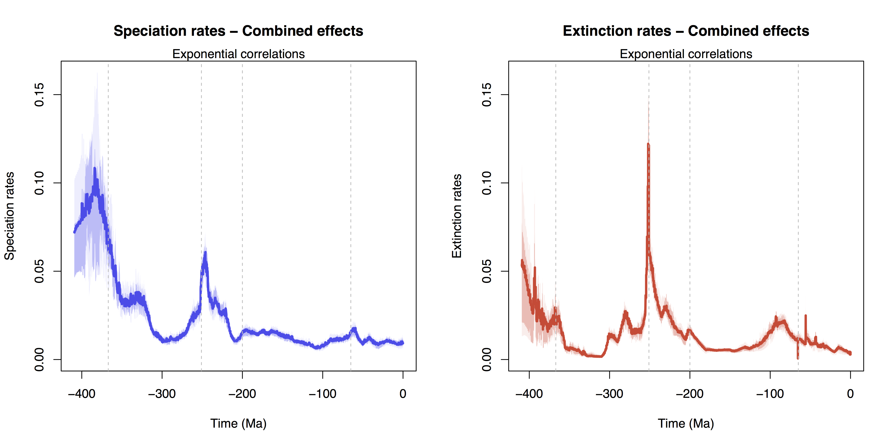

  

# PyRate 教程 \#4

***
#### 目录
* [多元出生-死亡模型（Multivariate Birth-Death models）](https://github.com/dsilvestro/PyRate/blob/master/tutorials/pyrate_tutorial_4.md#multivariate-birth-death-models-this-tutorial-is-work-in-progress)  
* [性状依赖的分化模型（Covar model）](https://github.com/dsilvestro/PyRate/blob/master/tutorials/pyrate_tutorial_4.md#trait-correlated-diversification)
* [年龄依赖性灭绝（ADE）模型](https://github.com/dsilvestro/PyRate/blob/master/tutorials/pyrate_tutorial_4.md#age-dependent-extinction-ade-models)

* [返回索引](https://github.com/dsilvestro/PyRate/tree/master/tutorials#pyrate-tutorials---index) 
***

# 多演化支多样性依赖模型（MCDD）
最初提出的 MCDD 模型的介绍见[此处](https://www.pnas.org/content/112/28/8684)，该模型在程序 `PyRateMCDD.py` 中实现，只需要一个输入文件（另见[示例文件](https://github.com/dsilvestro/PyRate/blob/master/example_files/Carnivores_MCDD.txt)）。该文件是一张制表符分隔的表格，包含 4 列（若你有多个重复分析则可以更多），每一行对应一个物种：

* 第一列标识该物种所属的演化支，编号从 0、1、2 等开始。  
* 第二列为物种标识符  
* 第三列和第四列分别为在先前一次 PyRate 分析中推断得到的物种起源时间和灭绝时间（这些时间可使用 `-ginput` 命令生成，方法见[此处](https://github.com/dsilvestro/PyRate/blob/master/tutorials/pyrate_tutorial_2.md#generate-input-file-for-pyratecontinuous)）

如果你对初始的 PyRate 分析进行了多个重复，可以将这些重复添加到 MCDD 输入文件中（见示例文件）。

输入文件准备就绪后，可以使用如下命令运行分析：

`PyRateMCDD.py -d /example_files/Carnivores_MCDD.txt -n 10000000 -s 10000`

其中选项 `-n` 和 `-s` 分别指定马尔可夫链蒙特卡洛（MCMC）的迭代次数和取样频率。默认情况下，程序一次性分析所有演化支。不过，你也可以使用选项 `-c` 每次只分析一个演化支（即在考虑来自其自身多样性以及所有其他演化支多样性的依赖作用下，分析某一特定演化支的出生-死亡过程）。例如

`PyRateMCDD.py -d /example_files/Carnivores_MCDD.txt -n 10000000 -s 10000 -c 0`

将估计所有演化支对第一个演化支物种形成和灭绝所产生的多样性依赖效应。

MCDD 模型实现了一种贝叶斯变量选择算法，它使用取值可为 0 或 1 的指示变量，依据多样性依赖参数在解释速率变异方面的重要程度，来决定启用或关闭这些参数。推断多演化支多样性依赖的另一种替代方法在下文介绍的多元出生-死亡模型（MBD）中实现，该方法采用马蹄形先验（horseshoe prior）算法来执行变量选择。两种方法的表现在[这篇论文](http://www.evolutionary-ecology.com/abstracts/v18/3010.html)中进行了比较，结果表明后一种方法可能更为可取。  

# 多元出生-死亡模型（MBD）

MBD 模型允许将物种形成率和灭绝率估计为多个时间连续变量的函数[(Lehtonen, Silvestro et al. 2017)](https://www.nature.com/articles/s41598-017-05263-7)。该模型假设用线性函数或指数函数把出生-死亡率的时间变化与一个或多个变量的变化联系起来。
在 MBD 模型下，会为每个变量各估计一个相关参数（物种形成与灭绝分别对应一个）。

采用**马蹄形先验算法**（更多细节见[此处](https://www.nature.com/articles/s41598-017-05263-7)）将相关参数向零收缩，从而降低过度参数化的风险，同时也无需进行显式的模型检验。 

**或者，也可以使用 gamma 超先验（gamma hyper-priors）**来约束相关参数并防止过度参数化（见[下文](https://github.com/dsilvestro/PyRate/blob/master/tutorials/pyrate_tutorial_4.md#additional-options)）。当只检验少量变量时（例如 2-4 个关联变量），应优先选择该选项。

MBD 模型在程序 `PyRateMBD.py` 中实现，其主输入文件是一张[包含估计物种形成时间与灭绝时间的表格](https://github.com/dsilvestro/PyRate/blob/master/tutorials/pyrate_tutorial_2.md#generate-input-file-for-pyratecontinuous)。此外，它还需要一组预测变量，以单独文件的形式提供并存放在同一个目录中。
每个预测变量都应提供为一张带表头、制表符分隔的表格，包含距今时间（time before present）和预测变量值两列，例如

time | predictor
----- | -------
0	| 0.06
1	| 0.0665
2	| 0.073
3	| 0.0795
4	| 0.086

示例文件见[此处](https://github.com/dsilvestro/PyRate/tree/master/example_files/predictors_MBDmodel)。

要启动一次 MBD 分析，必须提供输入文件以及所有预测变量文件所在的路径：

`./PyRateMBD.py -d /example_files/Ferns_SE.txt -var /example_files/predictors_MBDmodel -m 1`

其中 `-m 1` 指定相关模型的类型，可选项为 `-m 0`（指数型相关，默认）和 `-m 1`（线性相关）。
选项 `-var` 用于指定包含所有预测变量的文件夹路径。

### 使用 MBD 模型进行多演化支多样性依赖分析
若要将 MBD 模型用于多演化支多样性依赖分析，应提供所有演化支的多样性轨迹作为预测变量。格式正确的多样性轨迹文件可以使用 PyRate 的 `-ltt` [命令](https://github.com/dsilvestro/PyRate/blob/master/tutorials/pyrate_tutorial_2.md#plot-range-through-diversity-trajectory-lineage-through-time-plot)生成。

### 附加选项  
* `-out outname` 为输出文件名添加指定字符串   
* `-rmDD 1` 移除自身多样性依赖（默认包含在分析中） 
*  `-minT 2.58` 在最短时间处截断（例如在 2.58 Ma 处）
* `-maxT 23` 在最长时间处截断（例如在 23 Ma 处）
* `-hsp 0` 使用 gamma 超先验代替马蹄形先验
* `-n 10000000`  MCMC 迭代次数
* `-s 5000`      取样频率

MBD 分析默认使用马蹄形先验。不过，可以用 gamma 超先验来替代，即把 gamma 超先验施加于相关参数之高斯先验的精度参数（1/方差）上。做法是添加选项：`-hsp 0`。

### 结果汇总
可以使用命令 `-plot <logfile>` 绘制 MBD 模型所预测的边缘物种形成率和边缘灭绝率随时间的变化图。绘制 MBD 分析的结果时，必须指定输入数据、包含所有预测变量的目录以及相关模型类型（线性或指数）：

`./PyRateMBD.py -d /example_files/Ferns_SE.txt -var /example_files/predictors_MBDmodel -m 1 -plot Ferns_SE_0_lin_MBD.log`

使用马蹄形先验时，`plot` 函数还会计算所有预测变量的收缩权重（_Wl_ 和 _Wm_ 分别对应物种形成和灭绝）。收缩权重用于量化每个相关因子的统计支持度。相关参数在日志文件中以 _Gl_ 和 _Gm_ 表示，其后验估计同样显示在由 `-plot` 命令生成的图中（也可以在 [Tracer](http://tree.bio.ed.ac.uk/software/tracer/) 中打开 _mcmc.log_ 文件轻松获得）。

# 性状相关分化
PyRate 实现了一些出生-死亡模型，其中物种形成率和灭绝率按谱系各自特有的方式变化，变化的驱动力是其与某一连续性状之间估计得到的相关关系（Covar 模型）。该模型的介绍见[此处](http://onlinelibrary.wiley.com/doi/10.1111/2041-210X.12263/abstract)。 

### 提供性状文件
使用命令 `-trait_file` 可以提供一张表格（制表符分隔的文本文件），给出化石数据集中各物种的性状值。表格的第一列应包含物种名称（与 PyRate 文件中使用的名称完全一致），第二列提供性状值（[见示例文件](https://github.com/dsilvestro/PyRate/blob/master/example_files/Ursidae_bm.txt)）。没有性状数据的物种可以从表格中省略。或者，也可以把它们列入表格并将性状值设为 `NA`。这些物种仍会被纳入分析，但其性状值将由 MCMC 插补得到。

性状值可以（而且通常应当）进行对数变换。这可以使用命令 `logT` 完成：  
`-logT 0` 性状不做变换  
`-logT 1` 性状取 log_e 对数变换  
`-logT 2` 性状取 log10 对数变换

### 设置 Covar 模型
使用命令 `-mCov` 设置 Covar 模型：在这类模型中，出生-死亡率（以及保存率）在各谱系之间存在差异，其原因是它们与某一连续性状存在相关关系；该性状作为观测量提供，相关参数（cov_sp, cov_ex, cov_q）由模型估计得到。
示例：  
`-mCov 1` 物种形成率相关  
`-mCov 2` 灭绝率相关  
`-mCov 3` 物种形成率和灭绝率相关  
`-mCov 4` 保存率相关  
`-mCov 5` 物种形成率、灭绝率、保存率相关  

关于相关参数的默认先验是一个以 0 为中心、标准差 = 1 的正态分布。标准差可以用命令 `-pC` 修改，例如 `-pC 0.1` 将标准差设为 0.1。另外，相关参数之正态先验的标准差也可以直接从数据中估计（使用超先验；更多细节见[此处](https://royalsocietypublishing.org/doi/full/10.1098/rspb.2016.2361)），做法是设置 `-pC 0`。**注意**，当估计一个以上的相关参数时（即使用 `-mCov 3` 或 `-mCov 5` 时），通常更推荐该选项。

一次典型的分析用以下命令启动：

`./PyRate.py Ursidae_example_PyRate.py -trait_file Ursidae_bm.txt -mCov 5 -logT 10 -pC 0`

示例文件见[此处](https://github.com/dsilvestro/PyRate/blob/master/example_files)。

# 年龄依赖性灭绝（ADE）模型

### ADE 模型的贝叶斯实现
注：另一种利用深度神经网络的年龄依赖性灭绝模型实现（名为 ADE-NN）在这篇[开放获取论文](https://onlinelibrary.wiley.com/doi/full/10.1111/ele.13441)中有介绍，实现该模型的代码见[此处](https://github.com/dsilvestro/PyRate/tree/master/ADE-NN)。

检验年龄依赖性灭绝要比给估计出的物种寿命拟合一个威布尔分布更复杂，因为后者没有考虑未被观测到的物种，而这些物种很可能正是存续时间很短的那些（[Hagen et al. 2017](https://academic.oup.com/sysbio/article/doi/10.1093/sysbio/syx082/4563320/Estimating-Agedependent-Extinction-Contrasting)）。
ADE 模型在 PyRate 中以独立的函数实现，需要一个包含所有化石产出记录的[输入文件](https://github.com/dsilvestro/PyRate/blob/master/tutorials/pyrate_tutorial_1.md#generate-pyrate-input-file-option-1)。
例如

`python PyRate.py <your_dataset> -ADE 1 -qShift epochs.txt`

其中 -ADE 1 指定你要运行 ADE 模型，-qShift 则设定一个带速率转变的保存模型（[TPP 模型](https://github.com/dsilvestro/PyRate/blob/master/tutorials/pyrate_tutorial_1.md#defining-the-preservation-model)。注意，ADE 模型只能与齐次泊松过程（HPP）和时变泊松过程配合使用。 

ADE 模型假设灭绝率仅仅是物种年龄的函数，且平均速率不随时间变化。因此，应在物种形成率和灭绝率大致恒定的时间窗口内检验 ADE 模型。在 PyRate 中，你可以使用命令 `-filter` 剔除指定时间范围之外的所有分类单元，例如 

`python PyRate.py <your_dataset> -ADE 1 -qShift epochs.txt -filter 23.03 5.3`

将只分析所有化石产出记录都位于中新世之内的分类单元。ADE 分析的输出文件包含威布尔分布的形状参数和尺度参数的估计值。如果形状参数与 1 无显著差异，则不存在年龄依赖性灭绝率的证据。形状参数小于 1 表明灭绝率在物种生命史的最初阶段最高，并随物种年龄的增加而降低；反之，形状参数大于 1 表明灭绝率随物种起源以来的时间增加而上升。 

# 出生-死亡时间种（BDC）模型

在 BDC 模型下可以对化石数据和系统发育数据进行联合分析，方法见 [Silvestro, Warnock, Gavryushkina & Stadler 2018](https://www.nature.com/articles/s41467-018-07622-y)。该分析需要两个输入文件：一个标准 PyRate 输入数据集（可按[此处](https://github.com/dsilvestro/PyRate/blob/master/tutorials/pyrate_tutorial_1.md#generate-pyrate-input-file-option-2)的说明生成；另见[示例](https://github.com/dsilvestro/PyRate/tree/master/example_files/BDC_model)）。

要运行化石与系统发育数据的联合分析，应提供标准 PyRate 输入文件（化石产出记录数据）和一个树文件（NEXUS 格式）：

`python PyRate.py example_files/BDC_model/Feliformia.py -tree example_files/BDC_model/Feliformia.tre`

注意，该功能需要 [Dendropy 库](https://dendropy.org)。 

默认情况下，该分析假设速率恒定的出生-死亡模型，并且化石数据与系统发育数据之间的速率参数相互独立。 
选项 `-bdc` 强制**在 BDC 模型下采用相容的物种形成率与灭绝率**，而选项 `-eqr` 则设定**速率相等**。

若要在 **BDC 天际线模型（BDC skyline model）**下运行，可以使用 `-fixShift` 命令，说明见[此处](https://github.com/dsilvestro/PyRate/blob/master/tutorials/pyrate_tutorial_1.md#speciation-and-extinction-rates-within-fixed-time-bins)，例如：

`python PyRate.py example_files/BDC_model/Feliformia.py -tree example_files/BDC_model/Feliformia.tre -fixShift example_files/epochs.txt -bdc`

该命令在 BDC 相容模型下建立了这样一个分析：速率转变设置在各地质世（epoch）的边界处。

用于绘制 BDC 模型和 BDC 天际线模型结果的 R 绘图函数见[此处](https://github.com/dsilvestro/PyRate/blob/master/plot_functions_BDC_model.R)。

