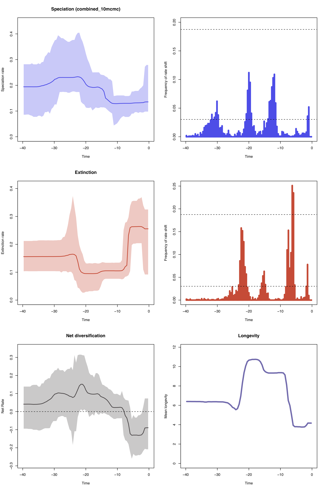

  

# PyRate 教程 \#3 RJMCMC
  
***
#### 目录
* [使用 RJMCMC 设置分析](https://github.com/dsilvestro/PyRate/blob/master/tutorials/pyrate_tutorial_3.md#setting-up-an-analysis-using-rjmcmc)  
* [RJMCMC 输出](https://github.com/dsilvestro/PyRate/blob/master/tutorials/pyrate_tutorial_3.md#rjmcmc-output)  
* [汇总模型概率](https://github.com/dsilvestro/PyRate/blob/master/tutorials/pyrate_tutorial_3.md#summarize-model-probabilities)    
* [绘制速率随时间的变化与速率转变](https://github.com/dsilvestro/PyRate/blob/master/tutorials/pyrate_tutorial_3.md#plot-rates-through-time-and-rate-shifts)  
* [合并多个重复运行的日志文件](https://github.com/dsilvestro/PyRate/blob/master/tutorials/pyrate_tutorial_3.md#combine-log-files-from-multiple-replicates)
  
* [在大型数据集上运行 PyRate](https://github.com/dsilvestro/PyRate/blob/master/tutorials/pyrate_tutorial_3.md#running-pyrate-on-large-datasets)
* [约束起源时间与灭绝时间](https://github.com/dsilvestro/PyRate/blob/master/tutorials/pyrate_tutorial_3.md#constraining-origination-and-extinction-times)
* [返回索引](https://github.com/dsilvestro/PyRate/tree/master/tutorials#pyrate-tutorials---index)  

***

# 使用可逆跳转 MCMC（Reversible Jump MCMC）估计速率变异

## 使用 RJMCMC 设置分析
我们最近在 PyRate 中实现了一种新算法，它使用 RJMCMC（Green 1995）来代替 BDMCMC（见于 Silvestro et al. 2014，通过命令 `-A 2` 调用）。该方法在[这篇开放获取论文](https://www.cambridge.org/core/journals/paleobiology/article/improved-estimation-of-macroevolutionary-rates-from-fossil-data-using-a-bayesian-framework/334F08A74A6C92F1FEAD91A71FE59A1C)中有详细介绍，模拟结果显示它比 BDMCMC 更为准确。

RJMCMC 分析通过命令 `-A 4` 来设置。请注意，该算法既适用于化石产出记录数据（occurrence data）
例如：

`python PyRate.py .../Canis_pbdb_data_PyRate.py -A 4 -mHPP -mG`

也适用于具有固定起源时间与灭绝时间的数据集（另见教程 \#2）：

`python PyRate.py -d Canidae_1_G_se_est.txt -A 4`

你可以在[这里](https://github.com/dsilvestro/PyRate/blob/master/tutorials/pyrate_tutorial_1.md#generate-pyrate-input-file-option-1)
和[这里](https://github.com/dsilvestro/PyRate/blob/master/tutorials/pyrate_tutorial_1.md#generate-pyrate-input-file-option-2)找到有关准备输入文件（input file）的更多细节。

默认情况下，RJMCMC 假定速率转变（rate shift）的时间服从均匀先验（prior），并附加一项约束：任一时间分箱不得小于 1 个时间单位（例如 1 myr）。要更改该先验，可以使用标志 `-min_dt` 来指定时间分箱允许的最小时长，例如：

`python PyRate.py -d Canidae_1_G_se_est.txt -A 4 -min_dt 0.5`

这允许各速率转变之间至少相隔 0.5 myr。请注意，将该参数设置为过小的值可能导致结果不稳定，对于小数据集尤其如此。  

## RJMCMC 输出
RJMCMC 分析默认生成 4 个输出文件（output file）：
####  1) sum.txt  
   文本文件，提供本次分析所使用的完整设置列表。  
#### 2)  mcmc.log   
以制表符分隔的表格，其中包含后验（posterior）的马尔可夫链蒙特卡洛（MCMC）样本、先验（prior）、保存过程（preservation process）的似然（likelihood）与出生-死亡模型（birth-death model）的似然（分别以 *PP_lik* 和 *BD_lik* 表示）、保存率（preservation rate）（*q_rate*）、其 gamma 分布异质性的形状参数（*alpha*）、所采样到的速率转变数目（*k_birth*、*k_death*）、最古老谱系（lineage）的起源时间（*root_age*）、总分支长度（*tot_length*），以及数据集中所有分类单元的物种形成（speciation）时间与灭绝（extinction）时间（分别以 *\*_TS* 和 *\*_TE* 表示，若为估计值）。当使用保存过程的 TPP 模型时，各转变点之间的保存率按 *q_0, q_1, ... q_n* 表示（由老到新）。
#### 3) sp\_rates.log, ex\_rates.log
以制表符分隔的文本文件，提供所采样到的速率以及速率转变的时间。请注意，由于在 RJMCMC 过程中速率转变的数目很可能发生变化，该文本文件的列数并不固定。该文件可以使用命令 `-plotRJ` 进行分析，从而获得速率随时间变化的边缘速率图，以及速率转变最可能出现的时间位置（如果有的话）（见下文）。 

#### 4) marginal\_rates.log（旧格式）
作为替代，可以在设置分析时使用命令 `-log_marginal_rates 1` 来获得另一个输出文件（即 [教程 \#1 中描述的 **marginal_rates.log** 文件](https://github.com/dsilvestro/PyRate/blob/master/tutorials/pyrate_tutorial_1.md#output-files)）。请注意，该输出可以使用命令 `-plot` 进行处理，以获得速率随时间变化图（见教程 #1），但不能使用命令 `plotRJ` 进行分析，以评估显著速率转变的时间位置。

## 汇总模型概率
**mcmc.log** 文件可用于计算具有不同速率转变数目的出生-死亡模型的采样频率。这通过使用 PyRate 命令 `-mProb` 并在其后跟上日志文件来实现：

`python PyRate.py -mProb .../Canis_pbdb_data_mcmc.log -b 200`

其中标志 `-b 200` 表示将去除前 200 个样本（即前 200,000 次迭代，如果采样频率设置为 1,000 的话）。该命令将提供一个表格（打印在屏幕上），列出具有不同速率转变数目的出生-死亡模型的相对概率。 

## 绘制速率随时间的变化与速率转变
**sp_rates.log** 和 **ex_rates.log** 文件可使用函数 `-plotRJ` 来生成速率随时间变化（RTT）图：

`python PyRate.py -plotRJ .../path_to_log_files/ -b 200`

这将生成一个 R 脚本和一个 PDF 文件，其中的 RTT 图展示了物种形成速率与灭绝速率随时间的变化。它还会显示推断出的速率转变时间的直方图（histogram），并计算贝叶斯因子（Bayes Factors），以帮助确定速率转变在何时得到显著后验概率的支持。直方图中包含两条水平虚线，分别指示存在速率转变的正向证据阈值（下方虚线：logBF = 2）与存在速率转变的强证据阈值（上方虚线：logBF = 6）。因此，直方图中任何显示速率转变采样频率超过上述阈值的点，都表示存在显著速率变化的时间。

请注意，**该命令需要的是日志文件所在的路径（而非文件本身）**。如果在该目录中找到多个兼容的文件，它们将被分别绘制。不过所有单独的图都会合并进同一个 R 脚本和同一个 PDF 文件。若要将绘图功能限制于某一个或某几个选定的日志文件，可以使用命令 `-tag`。例如，使用命令 `-tag Canis_pbdb` 将只对文件名中包含 "*Canis_pbdb*" 的日志文件计算 RTT 图。

`plotRJ` 函数还有额外的可用命令来调整其设置。命令 `-grid_plot` 定义用于计算边缘速率和速率转变时间的时间分箱大小。默认值为 `-grid_plot 0`，即设定分箱大小，使整个数据集的时间范围内共获得 100 个分箱。
该值可以改为任意较小的正值，以改变图的分辨率。例如 `-grid_plot 0.1` 将分箱大小设为 0.1 Myr。

命令 `-root_plot` 可用于将图截断到指定的最大年龄。例如使用 `-root_plot 10` 将只显示最近 10 个时间单位内的边缘速率。类似地，`-min_age_plot` 可用于在指定的最小年龄处截断速率随时间变化图。例如 

`python PyRate.py -plotRJ .../path_to_log_files/ -b 200 -root_plot 23 -min_age_plot 5.3` 

生成仅覆盖中新世的图。 

可添加命令 `-logT 1` 来绘制经 log10 转换的速率随时间变化图。
如果在分析中修改了**关于时间分箱之间最小时长的先验**，那么在对结果绘图时也应当指定该设置，例如，基于上面的示例：

`python PyRate.py -plotRJ .../path_to_log_files/ -b 200 -min_dt 0.5`

## 合并多个重复运行的日志文件
PyRate 包含一个实用函数，可将不同运行（run）的输出文件合并为一个文件。假设前述各分析的所有输出文件都位于同一个 pyrate mcmc logs 目录中，则可用以下命令合并日志文件： 

`python PyRate.py -combLogRJ /pyrate_mcmc_logs -b 1000 -tag Canis`

 其中：`-combLogRJ .../pyrate_mcmc_logs` 提供日志文件的完整路径，`-b 1000` 指定应去除前 1,000 个样本作为烧录期（burn-in），`-tag x` 指定只合并文件名中包含 `x`（上例中的单词 _Canis_）的全部文件。该命令生成三个输出文件，分别命名为“combined\_[n]\_mcmc.log”、"combined\_[n]\_sp\_rates.log" 和 "combined\_[n]\_ex\_rates.log"，其中 [n] 为所合并的重复运行的数目。 

为避免产生过大的合并文件，你可以使用标志 `-resample` 对日志文件进行二次抽样。例如命令

`python PyRate.py -combLogRJ .../pyrate_mcmc_logs -b 1000 -tag Canis -resample 100` 

指定从每个重复运行中随机抽取 100 个样本，并保存到合并后的日志文件中。 

对于 `mcmc.log` 文件，你还可以使用命令 `-combLog`（另见[这里](https://github.com/dsilvestro/PyRate/blob/master/tutorials/pyrate_tutorial_1.md#combine-log-files-across-replicates)）来选择你希望包含在合并日志文件中的列。例如，添加标志 `-col_tag posterior root_age death_age` 将只合并表头为 `posterior`、`root_age` 和 `death_age` 的三列（而忽略所有其他参数）。请注意，运行 [`-plotRJ`](https://github.com/dsilvestro/PyRate/blob/master/tutorials/pyrate_tutorial_3.md#plot-rates-through-time-and-rate-shifts) 函数只需要 `root_age` 和 `death_age`。

## 在大型数据集上运行 PyRate
在非常大的数据集（例如包含数百或数千个谱系）上运行 PyRate 分析，可能需要很长的计算时间才能使 MCMC 达到收敛（convergence）。为加快这一过程，可以使用近似 Gibbs 采样器来更高效地抽样起源时间与灭绝时间，如 [Moharrek et al. 2022 Palaeontology](https://doi.org/10.1111/pala.12586) 一文中所述。要使用该选项设置分析，可以使用标志 `-se_gibbs`，并修改更新频率，使绝大部分更新（> 90%）集中于物种形成、灭绝和保存率：

`python PyRate.py .../Rhinocerotidae_PyRate.py -qShift .../epochs_q.txt -se_gibbs -fU 0.35 0.6 0`

如果你的分析包含大量保存率转变，你可能需要调整保存参数的提议频率与窗口大小，以改善并加快收敛。通常以下设置会有帮助： 

`-fQ 0.1 -tQ 1.05 1.05`

**注意** 
* 该模型仅适用于基于同质泊松过程或时变泊松过程（HPP 或 TPP）的保存模型。
* 该模型与 RJMCMC 结合使用，可能导致物种形成与灭绝速率随时间的变化被“平滑”处理。避免这一情况的一种选择是使用 `-fixShift` 设置预先定义的速率转变时间（见[教程 1](https://github.com/dsilvestro/PyRate/blob/master/tutorials/pyrate_tutorial_1.md#speciation-and-extinction-rates-within-fixed-time-bins)）。另一种选择是先运行分析（带 `-fixShift`），提取起源时间与灭绝时间（如[这里](https://github.com/dsilvestro/PyRate/blob/master/tutorials/pyrate_tutorial_2.md#extract-estimated-times-of-origination-and-extinction)所示），然后使用 `-d` 命令，以固定的起源时间和灭绝时间运行 RJMCMC 算法。 

## 约束起源时间与灭绝时间
推断得到的起源时间与灭绝时间可以被约束为不早于或不晚于某个指定的年龄。

对起源时间和灭绝时间施加界限，需要一个以制表符或逗号分隔的文本文件。第一列给出分类单元的名称，第二列是其最早的起源时间，第三列是最晚的起源时间，第四列是最早的灭绝时间，第五列是最晚的灭绝时间。当某个起源时间或灭绝时间不应受到约束时，相应的单元格应填写 _NA_。两类界限都不需要的分类单元不必包含在该文本文件中。

如果我们确知某些分类单元是在大灭绝事件中灭绝的（设置 min_te），或者是在某个时间点之后才起源的（设置 max_ts），那么对起源时间与灭绝时间设置界限可能是合适的。如果我们的产出记录全都晚于某个年龄，但已知该分类单元实际上起源得早得多，那么设置最小起源年龄（min_ts）会很有用。

| taxon            | max_ts  | min_ts  | max_te | min_te  |
| ---------------- |:-------:|:-------:|:------:| -------:|
| Anolcites        | 251.902 | NA      | NA     | 201.4   |
| Acanthoscaphites | NA      | NA      | NA     | 66.0    |
| Glatziella       | 372.15  | NA      | NA     | NA      |
| Sabaliceras      | NA      | 276.1   | NA     | 251.902 |

`python ./PyRate.py ./example_files/Ammonoidea.py -bound_se ./example_files/Ammonoidea_bound_se.txt`

起源时间与灭绝年龄的界限可以与 Gibbs 采样器结合使用，例如：

`python ./PyRate.py ./example_files/Ammonoidea.py -bound_se ./example_files/Ammonoidea_bound_se.txt -qShift ./example_files/epochs_q.txt -se_gibbs -fU 0.35 0.6 0`

