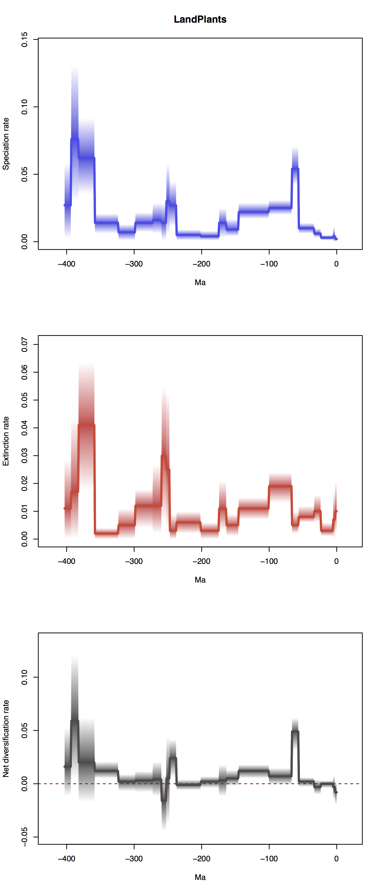

##### `-data_info` 
该函数会在屏幕上显示有关某一化石数据集（PyRate 输入文件）的若干汇总统计量：物种数目、作为单例（singleton）而被排除的物种数目（如适用；参见函数 [`-singleton`](https://github.com/dsilvestro/PyRate/wiki/2.-PyRate:-command-list#-singleton)）、现生类群数目、化石产出记录数目、数据集的观测时间跨度。

### 输出文件说明
一次典型的 PyRate 分析会产生三个输出文件：

##### _*_sum.txt_  
文本文件，提供本次分析所使用的全部设置参数的完整列表。

##### _*_mcmc.log_ 
制表符分隔的表格，其中包含以下项目的 MCMC 抽样值：后验、先验、保存过程的似然与出生-死亡过程的似然 
 （分别以 `PP_lik` 和 `BD_lik` 表示）、保存率（`q_rate`）、保存率异质性的伽马分布形状参数（`alpha`）、Covar 模型的参数（`cov_sp`、`cov_ex`、`cov_q`）、所抽样的速率转变数目（`k_birth`、`k_death`；仅在 BDMCMC 分析中记录）、TI 分析中所用缩放因子的取值（`beta`）、最古老谱系的起源时间（root_age）、各速率转变之间的物种形成/灭绝速率（`lambda_0, lambda_1, ... and  mu_0, mu_1, ...`；仅在速率转变数目固定时记录，即使用 `-A 0` 或 `-A 1` 时）、物种形成与灭绝的速率转变时间（`shift_sp_1, ... and shift_ex_1, ...`；仅在使用 `-A 0` 或 `-A 1` 时记录）、总支长（tot_length），以及数据集中所有类群的物种形成时间与灭绝时间（分别对应 `*_TS` 和 `*_TE`）。在 BDMCMC 分析之后，该文件可用于通过函数 [`-mProb`](https://github.com/dsilvestro/PyRate/wiki/3.-Summarize-PyRate-results#-mprob) 计算具有不同速率转变数目的出生-死亡模型的抽样频率。此外，可以在 [Tracer](http://tree.bio.ed.ac.uk/software/tracer/) 程序中打开该文件，以检查 MCMC 的效率与混合情况以及烧录期（burn-in）所占比例。

##### _*_marginal_rates.log_ 
制表符分隔的表格，其中记录了物种形成、灭绝以及净分化（多样性增加）边际速率的后验抽样值，这些速率在 1 个时间单位（通常为 Myr）内计算得到。该文件可用于通过函数 [`-plot`](https://github.com/dsilvestro/PyRate/wiki/3.-Summarize-PyRate-results#-plot) 生成速率随时间变化（rates-through-time，RTT）图。

**注意：使用 `-A 4` 进行 PyRate 分析的默认输出如[此处](https://github.com/dsilvestro/PyRate/blob/master/tutorials/pyrate_tutorial_3.md)所述**

当运行分析以通过 TI 估计某一出生-死亡模型的边际似然时（选项 -A 1），‘*_marginal_rates.log’ 文件将被下列文件取代：

##### _*_marginal_likelihood.txt_ 
文本文件，提供通过 TI 估计得到的出生-死亡模型边际似然。该值可用于比较不同出生-死亡模型的相对拟合优度（例如具有不同速率转变数目、固定的转变时间、利用 Covar 模型得到的与性状相关的速率等）。可使用命令 [`-BF`](https://github.com/dsilvestro/PyRate/wiki/3.-Summarize-PyRate-results#-bf) 计算贝叶斯因子（Bayes Factors），以量化模型间的相对支持度。

***
### 结果绘图与汇总

**注意：使用 `-A 4` 进行 PyRate 分析的默认输出，以及结果的绘图方法，如[此处](https://github.com/dsilvestro/PyRate/blob/master/tutorials/pyrate_tutorial_3.md#rates-through-time-and-rate-shifts)所述**

##### `-plot`
该函数读取 PyRate 分析记录在一个或多个文件（名为 ‘*_marginal_rates.log’）中的边际物种形成速率与边际灭绝速率，并使用脚本语言 R 生成速率随时间变化（RTT）图。会生成两个输出文件：名为 ‘*_RTTplot.r’ 的 R 脚本和名为 ‘*_RTTplot.pdf’ 的 pdf 文件。前者包含用于生成保存在该 pdf 文件中的图形输出的 R 源代码。与其他所有输入文件一样，默认情况下这些文件将保存在与输入文件相同的目录中。随时间变化的边际物种形成、灭绝和净分化速率按 1 Myr 的时间片绘制，并给出各自相应的 95% HPD。`-plot` 函数的参数既可以是包含 ‘*_marginal_rates.log’ 文件的目录路径，也可以是单个 ‘*_marginal_rates.log’ 文件。当提供日志文件所在路径时，默认情况下该函数会取出指定目录中的每一个 ‘*_marginal_rates.log’ 并分别汇总成一幅图。可使用下文所述的 [`-tag`](https://github.com/dsilvestro/PyRate/wiki/3.-Summarize-PyRate-results#-tag) 命令来合并多个文件。可通过命令 [`-b`](https://github.com/dsilvestro/PyRate/wiki/2.-PyRate:-command-list#-b) 指定作为烧录期予以排除的 MCMC 样本数目（默认设为 1）。我们建议在 Tracer 中查看 ‘*_marginal_rates.log’ 文件，以确定合适的烧录期比例。 
示例：  
`-plot path_to_pyrate_results`  分别绘制目录中的每个日志文件  
`-plot path_to_pyrate_results/my_data_marginal_rates.log`  绘制单个文件

##### `-plot2`
该函数与 [`-plot`](https://github.com/dsilvestro/PyRate/wiki/3.-Summarize-PyRate-results#-plot) 函数等效，但生成的是带有渐变淡化可信区间的 RTT 图，如 [Silvestro et al. (2015 PNAS)](http://www.pnas.org/content/112/28/8684.full.pdf)（Fig. 2）中所示。
示例：  
`-plot2 path_to_pyrate_results`  分别绘制目录中的每个日志文件  
`-plot2 path_to_pyrate_results/my_data_marginal_rates.log`  绘制单个文件

右侧的示例展示了使用 `-plot2` 函数获得的陆生植物起源速率、灭绝速率和净分化速率（数据来自 [Silvestro et al. (2015 New Phyt)](http://onlinelibrary.wiley.com/doi/10.1111/nph.13247/abstract)）。

##### `-tag`
指定应将哪些文件合并到 RTT 图中。若未使用该参数，则每个边际速率文件都将单独绘制。
示例：  
`-plot path_to_pyrate_results -tag rhinos` 将所有文件名中包含 ‘rhinos’ 一词的 ‘*_marginal_rates.log’ 文件合并到一幅图中，而其他文件则被忽略。 

##### `-root_plot`
当把多个日志文件合并为一幅 RTT 图时（参见函数 [`-plot`](https://github.com/dsilvestro/PyRate/wiki/3.-Summarize-PyRate-results#-plot) 和 [`-tag`](https://github.com/dsilvestro/PyRate/wiki/3.-Summarize-PyRate-results#-tag)），用于设置图中的最大年龄。若设为 0，则该年龄将根据所有日志文件中最小的根年龄（root age）来确定。若 `root_plot n`，其中 `n>0`，则边际速率仅绘制到 `n` 为止的年龄。
示例：  
`-plot path_to_pyrate_results -tag rhinos -root_age 23` 将所有文件名中包含 ‘rhinos’ 一词的 ‘*_marginal_rates.log’ 文件合并到一幅图中，并且仅绘制新近纪（23 至 0 Ma）的边际速率。 

##### `-mProb` 
读取 BDMCMC 分析记录在文件（名为 ‘*_mcmc.log’）中的后验抽样值，以便在 BDMCMC 分析之后计算具有不同速率转变数目的出生-死亡模型的抽样频率。可通过命令 `-b` 指定要排除的烧录期比例（默认设为 0）。我们建议在 Tracer 中查看 ‘*_mcmc.log’ 文件，以确定合适的烧录期比例。
示例：`-mProb file_name_mcmc.log`

##### `-BF` 
读取在两个出生-死亡模型下计算得到的边际似然（来自 ‘*_marginal_likelihood.txt’ 文件），以计算贝叶斯因子并量化一个模型相对于另一个模型的支持程度。贝叶斯因子的计算方式为对数边际似然之差的两倍，并依据 [Kass and Raftery (1995)](http://amstat.tandfonline.com/doi/abs/10.1080/01621459.1995.10476572) 将支持程度划分为四个等级：可忽略（negligible）、明确（positive）、强（strong）、极强（very strong）。  
示例：`-BF path_to_file/file_1_marginal_likelihood.txt path_to_file/file_2_marginal_likelihood.txt`
