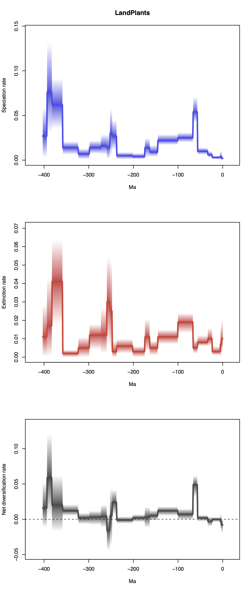

##### `-data_info` 
This function will plot on screen a few summary statistics about a fossil data set (PyRate input file): number of species, number of species excluded as singletons (when applicable; see function [`-singleton`](https://github.com/dsilvestro/PyRate/wiki/2.-PyRate:-command-list#-singleton)), number of extant taxa, number of occurrences, observed time span of the data set.

### Description of the output files
A typical PyRate analysis produces three output files:

##### _*_sum.txt_  
Text file providing the complete list of settings used in the analysis.

##### _*_mcmc.log_ 
Tab-separated table with the MCMC samples of the posterior, prior, likelihoods of the preservation process and of the 
 birth-death (indicated by `PP_lik` and `BD_lik`, respectively), the preservation rate (`q_rate`), the shape parameter of its gamma distributed heterogeneity (`alpha`), the parameters of the Covar model (`cov_sp`, `cov_ex`, `cov_q`), the number of sampled rate shifts (`k_birth`, `k_death`; only logged in BDMCMC analyses), the value of scaling factor used in TI analyses (`beta`), the time of origin of the oldest lineage (root_age), the speciation/ extinction rates between shifts (`lambda_0, lambda_1, ... and  mu_0, mu_1, ...`; only logged under fixed number of shifts, i.e. with `-A 0` or `-A 1`), the times of rate shifts in speciation and extinction (`shift_sp_1, ... and shift_ex_1, ...`; only logged with `-A 0` or `-A 1`), the total branch length (tot_length), and the times of speciation and extinction of all taxa in the data set (`*_TS` and `*_TE`, respectively). This file can be used to calculate the sampling frequencies of birth-death models with different number of rate shifts after a BDMCMC analysis using the function [`-mProb`](https://github.com/dsilvestro/PyRate/wiki/3.-Summarize-PyRate-results#-mprob). Additionally, the file can be opened in the program [Tracer](http://tree.bio.ed.ac.uk/software/tracer/) to check the efficiency and mixing of the MCMC and the proportion of burnin.

##### _*_marginal_rates.log_ 
Tab-separated table with the posterior samples of the marginal rates of speciation, extinction, and net diversification, calculated within 1 time unit (typically Myr). This file can be used to generate rates-through-time plots using the function [`-plot`](https://github.com/dsilvestro/PyRate/wiki/3.-Summarize-PyRate-results#-plot).

**NOTE that the default output for PyRate analysis using `-A 4` as explained [here](https://github.com/dsilvestro/PyRate/blob/master/tutorials/pyrate_tutorial_3.md)**

When running an analysis to estimate the marginal likelihood of a birth-death model by TI (option -A 1) the ‘*_marginal_rates.log’ file is replaced by the following:

##### _*_marginal_likelihood.txt_ 
Text file providing the marginal likelihood of a birth-death model estimated by TI. This value can be used to compare the relative fit of different birth-death model (e.g. with different number of shifts, fixed shift ages, trait-correlated rates using the Covar model, ...). The calculation of Bayes Factors to quantify the relative model support can be done using the command [`-BF`](https://github.com/dsilvestro/PyRate/wiki/3.-Summarize-PyRate-results#-bf).

***
### Plot/summarize results

**NOTE that the default output for PyRate analysis using `-A 4` and the results can be plotted as explained [here](https://github.com/dsilvestro/PyRate/blob/master/tutorials/pyrate_tutorial_3.md#rates-through-time-and-rate-shifts)**

##### `-plot`
This function takes the marginal speciation and extinction rates logged by a PyRate analysis in one or more files (named ‘*_marginal_rates.log’) and generates a rates-through-time plot (RTT) using the scripting language R. Two output files are generated: an R script named ‘*_RTTplot.r’ and a pdf file named ‘*_RTTplot.pdf’. The former contains the source R code for generating the graphic output saved in the pdf file. As for all the other input files, by default these files will be save in the same directory as the input file. Marginal speciation, extinction, and net diversification rates through time are plotted in 1 Myr time bins with the respective 95% HPDs. The `-plot` function takes as argument either the path to the directory containing the ‘*_marginal_rates.log’ file(s) or a single ‘*_marginal_rates.log’ file. When providing the path to the log files, by default, the function takes each ‘*_marginal_rates.log’ in the specified directory and summarizes it in a plot. Multiple files can be combined by using the [`-tag`](https://github.com/dsilvestro/PyRate/wiki/3.-Summarize-PyRate-results#-tag) command described below. The number of MCMC samples to be excluded as burnin can be specified using the command [`-b`](https://github.com/dsilvestro/PyRate/wiki/2.-PyRate:-command-list#-b) (by default set to 1). We recommend to inspect the ‘*_marginal_rates.log’ file in Tracer to define the appropriate proportion of burnin. 
Examples:  
`-plot path_to_pyrate_results`  plot each log file in a directory  
`-plot path_to_pyrate_results/my_data_marginal_rates.log`  plot a single file

##### `-plot2`
This function is equivalent to the [`-plot`](https://github.com/dsilvestro/PyRate/wiki/3.-Summarize-PyRate-results#-plot) function, but produces RTT plots with fading credible intervals as shown in [Silvestro et al. (2015 PNAS)](http://www.pnas.org/content/112/28/8684.full.pdf) (Fig. 2).
Examples:  
`-plot2 path_to_pyrate_results`  plot each log file in a directory  
`-plot2 path_to_pyrate_results/my_data_marginal_rates.log`  plot a single file

The example on the right shows origination, extinction, and net diversification rates of land plant obtained using the `-plot2` function (data from [Silvestro et al. (2015 New Phyt)](http://onlinelibrary.wiley.com/doi/10.1111/nph.13247/abstract)).

##### `-tag`
Specify which files should be combined in the RTT plot. When this argument is not used each marginal rate file will be plotted separately.
Example:  
`-plot path_to_pyrate_results -tag rhinos` combine all ‘*_marginal_rates.log’ files containing the word ‘rhinos’ in a single plot, whereas other files are ignored. 

##### `-root_plot`
When combining log files into a single RTT plot (see functions [`-plot`](https://github.com/dsilvestro/PyRate/wiki/3.-Summarize-PyRate-results#-plot) and [`-tag`](https://github.com/dsilvestro/PyRate/wiki/3.-Summarize-PyRate-results#-tag)), sets the maximum age in the plot. If set to 0, the age will be determined as the minimum root age across all log files. If `root_plot n`, where `n>0`, then the marginal rates will be plotted only up to an age of `n`.
Example:  
`-plot path_to_pyrate_results -tag rhinos -root_age 23` combine all ‘*_marginal_rates.log’ files containing the word ‘rhinos’ in a single plot and and only plot marginal rates for the Neogene (23 to 0 Ma). 

##### `-mProb` 
Takes the posterior samples logged in a BDMCMC analysis to a file (named ‘*_mcmc.log’) to calculate the sampling frequencies of birth-death models with different number of rate shifts after a BDMCMC analysis. The proportion of burnin to be excluded can be specified using the command `-b` (by default set to 0). We recommend to inspect  the ‘*_mcmc.log’ file in Tracer to define the appropriate proportion of burnin.
Example: `-mProb file_name_mcmc.log`

##### `-BF` 
Takes the marginal likelihoods calculated under two birth-death models (from ‘*_marginal_likelihood.txt’ files) to calculate Bayes Factors and quantify the support of one model against the other. The Bayes factor is calculated as twice the difference of log marginal likelihood and the degree of support divided into four categories: negligible, positive, strong, very strong, based on [Kass and Raftery (1995)](http://amstat.tandfonline.com/doi/abs/10.1080/01621459.1995.10476572).  
Example: `-BF path_to_file/file_1_marginal_likelihood.txt path_to_file/file_2_marginal_likelihood.txt`